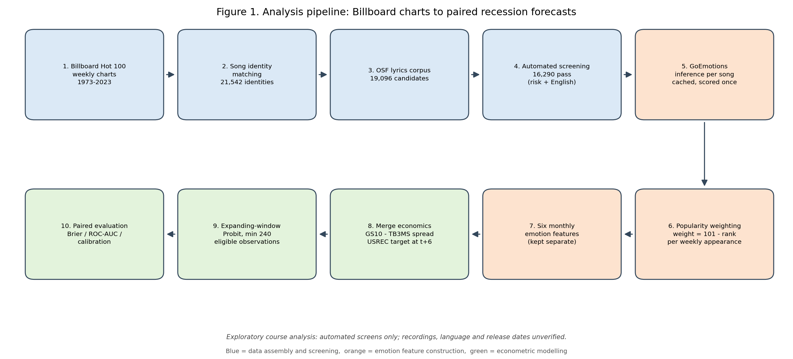
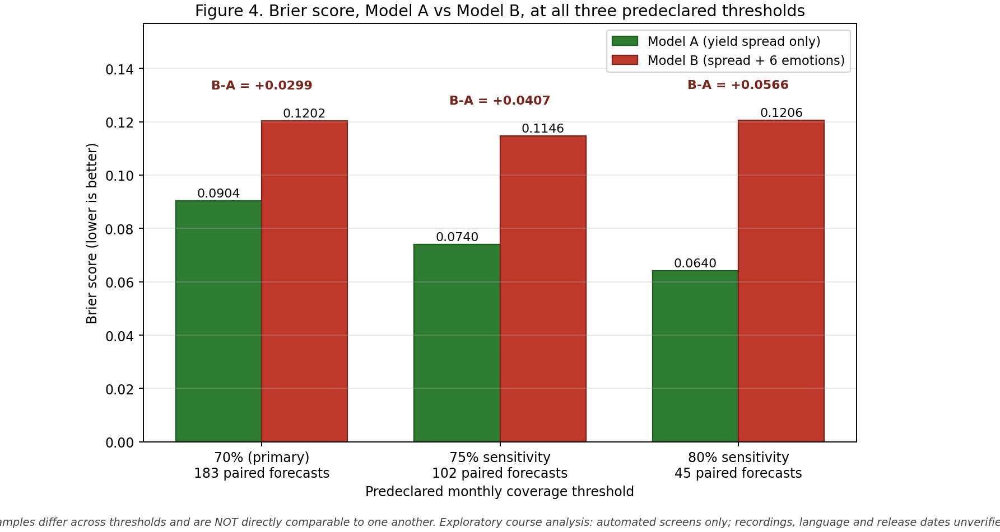

# Can Popular Music Predict U.S. Recessions?

**NYU Courant · Predictive Analytics · Fall 2026 · Team 5**
Keefer Wu · Nathan Starkman · Kiran Reddy Bhumireddy

We tested whether popularity-weighted lyric emotions improve forecasts of **U.S.
recession status six calendar months after the predictor month**. In the primary
exploratory sample, adding music increased Brier error from **0.0904 to 0.1202**
over **183 paired forecasts**. A training-rate reference scored **0.0830** and a
full-history yield-curve model scored **0.0848** on those same dates.

The finding is **no demonstrated incremental predictive benefit from these
features on this selected retrospective sample**. We make no significance,
causal, real-time deployment, or general absence-of-music-signal claim.
Dependence-aware uncertainty and PR-AUC are follow-up work in
[PR #2](https://github.com/kirankigi5/music_as_recession_alternate_data/pull/2).
Neither bootstrap convention from the earlier local investigation is canonical
in PR #1.

> These are exploratory coursework results. Lyric records passed automated
> metadata/risk and English-language screens; recording identity, language and
> release dates are not independently verified. Source use rests on reported
> instructor guidance for coursework, not a copyright licence or rights clearance.
> The separate strict evidence policy is unchanged and admits zero records.

## Read the project

| Purpose | Document |
|---|---|
| Concise professor update with figures | [Professor README](README_PROFESSOR.md) |
| Main results and benchmarks | [Exploratory results](docs/exploratory_results.md) |
| Review dispositions and follow-up boundary | [PR #1 closeout](docs/review_response.md) |
| Tested release commands and limits | [Validation record](docs/closeout_validation.md) |
| Full research history, methods and figures | [Research report](docs/COMPLETE_RESEARCH_REPORT.md) |
| Code map and next work | [Team handoff](docs/TEAM_HANDOFF.md) |
| Timing and evidence contracts | [Forecast protocol](docs/forecast_protocol.md), [model execution](docs/model_comparison.md), [course policy](docs/exploratory_course_policy.md) |
| Source-use and measurement gaps | [Source review](docs/osf_source_use_review.md), [lyrics validation](docs/lyrics_validation.md) |

## Question, data and implemented architecture

**Model A:** `P(USREC at t+6 = 1) = Phi(intercept + coefficient × spread_t)`.
**Model B:** the same Probit plus six monthly emotion predictors: joy, sadness,
fear, anger, nervousness and optimism.

`spread_t = GS10_t − TB3MS_t` is a **continuous difference in percentage points**,
not a binary inversion indicator. The outcome is binary; both models return
probabilities. A 4% long yield minus a 5% short rate is a −1 percentage-point
predictor. The existing implementation already meets that interpretation of the
TA's recalled request. Whether the TA meant a change in spread or a different
continuous target still needs clarification; no model change was invented.

| Data actually used | Role and scope |
|---|---|
| [FRED GS10](https://fred.stlouisfed.org/series/GS10), [TB3MS](https://fred.stlouisfed.org/series/TB3MS), [USREC](https://fred.stlouisfed.org/series/USREC) | Monthly yields and recession labels; bundled processed economic table has 876 rows, April 1953–March 2026 predictor months |
| [Weekly Billboard Hot 100 archive](https://github.com/mhollingshead/billboard-hot-100) | Actual weekly ranks; study uses 1973–2023 and 21,542 title/artist identities |
| [OSF historical lyrics](https://osf.io/2k7ut/) | 19,096 selected candidates; 16,290 pass the exploratory automated screens |
| [Pinned RoBERTa GoEmotions checkpoint](https://huggingface.co/SamLowe/roberta-base-go_emotions) | Frozen model used to score lyrics, not a separately collected outcome dataset |

Kaggle, LYDIA, LRCLIB and other sources were investigated for recovery/auditing;
they are not additional admitted lyric sources in the reported experiment.



The implemented flow is weekly charts → audited title/artist/source mapping →
local emotion scoring → monthly rank-weighted means → economic join → paired
expanding-window Probit evaluation. Modules live under `src/music_recession/`.
Each appearance has weight `101 − rank`; repeated weeks contribute repeatedly.
Emotion means divide by scored weight, while coverage divides by all observed
chart weight. Missing lyrics are not zero emotion vectors. Invalid/duplicate
chart slots are rejected; incomplete months and months with missing slots are
excluded. Long lyrics are scored in 480-content-token chunks with token-weighted
sigmoid pooling. Instrumentals and unresolved versions are excluded under policy.

The six features remain separate. No PCA or outcome-driven feature search was
used: reducing six preselected emotions would change the question and reduce
interpretability. Standardization is learned on training rows for numerical
conditioning; invertible scaling does not change ideal unpenalized Probit
probabilities. Alternative estimators, regularization and new horizons remain
separate experiments rather than remedies selected after seeing the result.

## Evaluation and findings

Both models train on **identical eligible rows** from January 1973, require at
least 240 observations, and refit for each evaluated month. A training target
must be at or before `t−1`; that enforces an assumed chronological boundary, not
historical NBER announcement availability. The assumed issuance is the 15th of
`t+1`; the target stays anchored to `t+6`, rather than six months after issuance.
Final economic data, retrospective labels and uncertain chart/lyric availability
make this **retrospective pseudo-out-of-sample** evaluation.

| Coverage | Forecasts | Recession months | A Brier | B Brier | A ROC-AUC | B ROC-AUC |
|---|---:|---:|---:|---:|---:|---:|
| 70% primary | 183 | 15 | 0.0904 | 0.1202 | 0.6462 | 0.4306 |
| 75% sensitivity | 102 | 9 | 0.0740 | 0.1146 | 0.8722 | 0.5424 |
| 80% sensitivity | 45 | 4 | 0.0640 | 0.1206 | 0.9878 | 0.7012 |

Brier is mean squared probability error; lower is better. The evaluated dates are
nested: 2001/GFC/COVID recession-month counts are **8/5/2**, **7/0/2**, and
**4/0/0**. Higher-threshold AUCs reflect changed samples and disappearing episodes.
Matching signs are not independent confirmations. The primary dates span
November 1993–December 2023, with targets May 1994–June 2024, and contain gaps.



The original broad-period Model A Brier **0.094921** uses 630 forecasts and must
not be compared directly with B. The **0.084754** full-history benchmark instead
selects exactly B's 183 dates from the existing baseline forecasts. It has more
training history than paired A; the original equal-training comparison remains
the controlled incremental-feature experiment.

Coverage declines over time, only three recession episodes are represented,
GoEmotions is unvalidated on these lyrics, and source matches remain provisional.
Model B has **44 months in [0.3, 0.8), including one recession**. Primary training
windows have 46–61 positive labels for eight parameters including the intercept:
**5.75–7.625 events per parameter**. These descriptive diagnostics do not establish
why B failed. The original primary analysis retains COVID; a separately labeled
post-hoc exclusion is recorded in the results summary.

## Reproduction levels

The numerical environment uses Python 3.9+ and NumPy/SciPy/statsmodels/matplotlib.
For a new environment, install `python -m pip install -e .` and pytest; the tested
baseline constraints are in `requirements-baseline.txt`. Optional NLP packages
are unnecessary for the saved-result checks and synthetic tests.

From the checkout root, after environment setup:

```sh
# Offline software tests; no model download or real lyric inference.
python -m pytest -q

# Recompute descriptive scores, benchmark, calibration and provenance checks.
# No model fitting, network or NLP inference. Default is read-only stdout.
python scripts/verify_saved_results.py

# Render the ten original figures from bundled derived data into a fresh path.
python scripts/make_research_figures.py --out /tmp/music-recession-figures-FRESH

# Optional verification output, separate from original experiment directories.
python scripts/verify_saved_results.py --output /tmp/music-recession-verification-FRESH.json
```

Replace `FRESH` with a new unused name. The validation record documents a test of
an index-only release tree without ignored raw files or caches. This demonstrates
saved-result and figure reproduction in the recorded environment, not a fresh
installation on every supported platform.

Full lyric inference additionally requires externally obtained raw sources,
untracked inventory/audit intermediates, optional `[music]` dependencies and
model weights. Public model loading may use the network. Existing directories
are refused by the experiment driver; use a fresh output directory and an
explicit cache path. See the [separate full-reproduction instructions](docs/closeout_validation.md#full-inference-is-a-separate-reproduction-level).

Historical manifests and predictions are preserved. Scores came from NLP hash
`614f862b…`; current `emotions.py` is `e5600454…`. The local cache comparison
found **7,490 shared score vectors identical**, with **8,800 songs lacking a
current-hash rerun**. Clean checkouts do not include those caches. We claim
reproduction of bundled derived results, not full current-code lyric inference.

## CRISP-DM and final deliverables

Business understanding is the incremental forecasting question; data understanding
is the source/coverage audit; preparation is matching, exclusions, chunking,
weighting and joins; modeling is paired Probit; evaluation uses probability loss
and discrimination on chronological dates. Delivery is the reproducible research
bundle and report, with no real-time deployment claim. The [closeout checklist](docs/review_response.md#final-deliverable-checklist)
maps the syllabus expectations to evidence and remaining presentation work.
