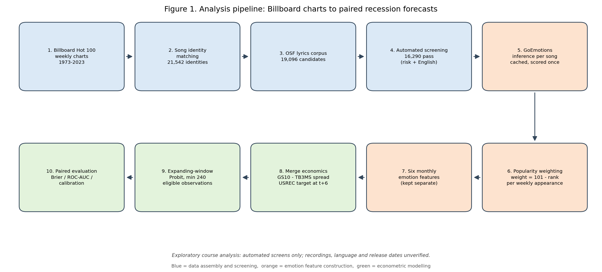
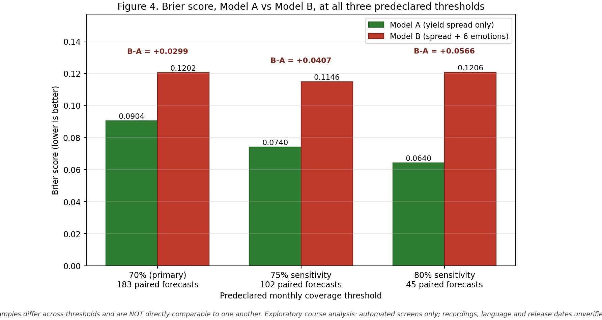
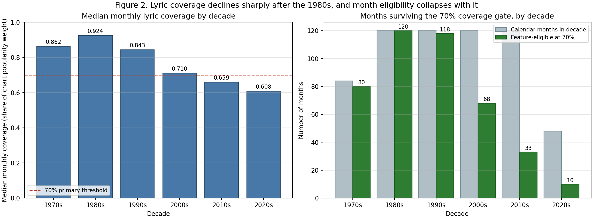

# Can Popular Music Predict U.S. Recessions?

**Project progress · November 17, 2026 · NYU Predictive Analytics · Team 5**
Keefer Wu · Nathan Starkman · Kiran Reddy Bhumireddy

## Where we are

We completed an exploratory experiment scoring **16,290 songs** and testing
whether their emotions improve recession forecasts. On **183 paired forecasts**,
adding six emotion indicators increased Brier error from **0.0904 to 0.1202**.
This is no demonstrated incremental benefit on the evaluated sample; statistical
uncertainty depends on block length and HAC lag. This PR #2 branch adds
[conditional uncertainty and average precision](docs/paired_inference.md) from
saved forecasts; it does not establish robust statistical degradation.

## Question, data and architecture

- Model A uses the **continuous GS10 − TB3MS spread in percentage points**.
- Model B adds joy, sadness, fear, anger, nervousness and optimism.
- Both are Probit models returning probabilities for the binary **USREC at t+6**
  target; they do not merely predict whether the yield curve is inverted.
- The assumed issuance is the 15th of t+1, so six months is measured from the
  predictor month. The experiment is retrospective pseudo-out-of-sample.
- Datasets: weekly **Billboard Hot 100 (1973–2023)**, **OSF historical lyrics**,
  and **FRED GS10, TB3MS, USREC**. A pinned RoBERTa GoEmotions model scores lyrics.

## Completed work and results

The pipeline includes source audits, title/artist matching, exclusion/completeness
checks, emotion extraction, popularity-weighted monthly aggregation, economic
joins, chronological training and paired evaluation. Missing lyrics reduce
coverage rather than becoming zero emotion scores.

| Coverage | Forecasts / recession months | A Brier | B Brier |
|---|---|---:|---:|
| 70% primary | 183 / 15 | 0.0904 | 0.1202 |
| 75% | 102 / 9 | 0.0740 | 0.1146 |
| 80% | 45 / 4 | 0.0640 | 0.1206 |

On the same 183 primary dates, a simple training-rate reference scores **0.0830**,
and the full-history yield-curve model scores **0.0848**. Both outperform paired
A and B. The original paired comparison keeps training data equal; the
full-history comparator provides more economic history.

## What review clarified

- Threshold samples are nested: 2001/GFC/COVID positive counts are **8/5/2**,
  **7/0/2**, **4/0/0**. Increasing AUC at stricter thresholds reflects episode removal.
- Model B's [0.3, 0.8) probabilities cover **44 months with one recession**.
- Eight parameters against 46–61 positive training labels means **5.75–7.625
  events per parameter**. Overfitting is a hypothesis, not an established cause.
- The TA's recalled continuous-spread/probability interpretation is already
  implemented; any intended change in target or spread definition needs clarification.

## Limitations and next steps

Median lyric coverage declines from **92.4% in the 1980s** to **60.8% in
2020–2023**. Only three recession episodes are represented. Recording matches,
language and release dates are not independently verified; GoEmotions is
unvalidated on these lyrics. Final economic data and retrospective labels prevent
a real-time forecasting claim. Source use is based on reported coursework guidance.

Next, review PR #2's dependence-aware evaluation, finish the presentation, and
prioritize matching/emotion validation if time permits. No new model was added to
chase an improvement. A local cache check found 7,490 shared score vectors identical
across code hashes; 8,800 songs still lack a current-hash rerun.

See the [results](docs/exploratory_results.md), [review dispositions](docs/review_response.md),
[validation record](docs/closeout_validation.md) and [full report](docs/COMPLETE_RESEARCH_REPORT.md).
