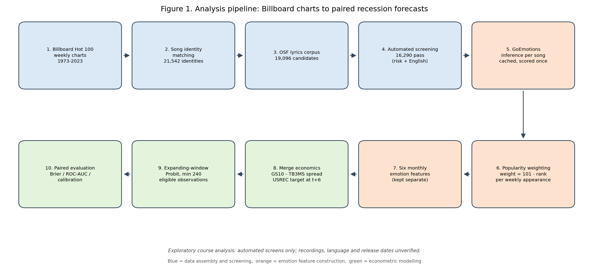
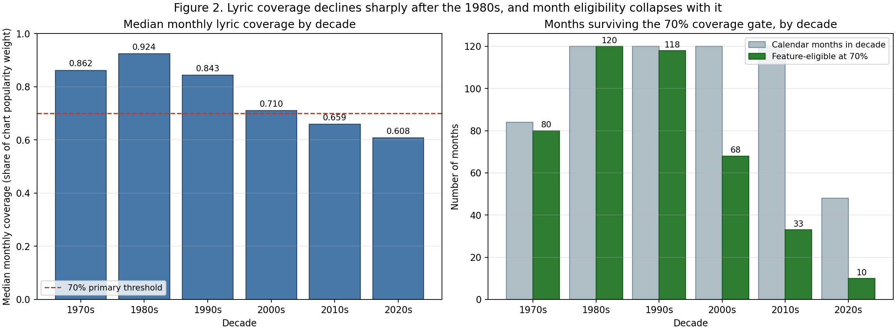
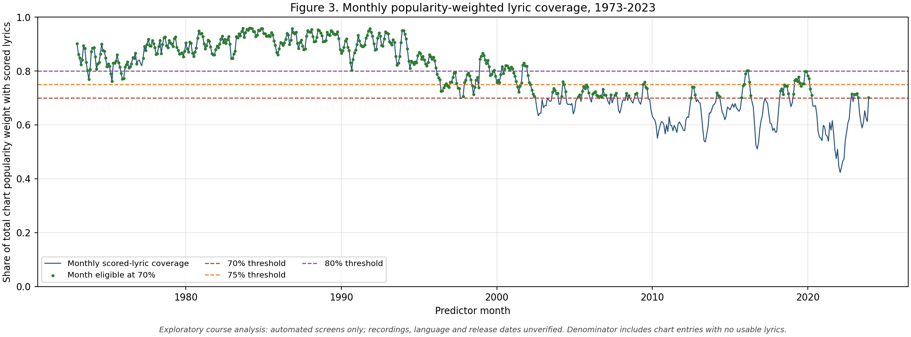
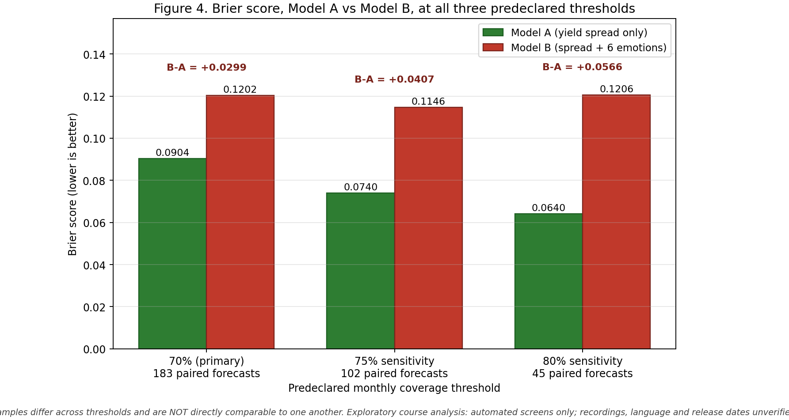
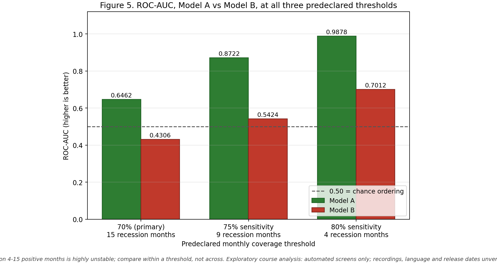
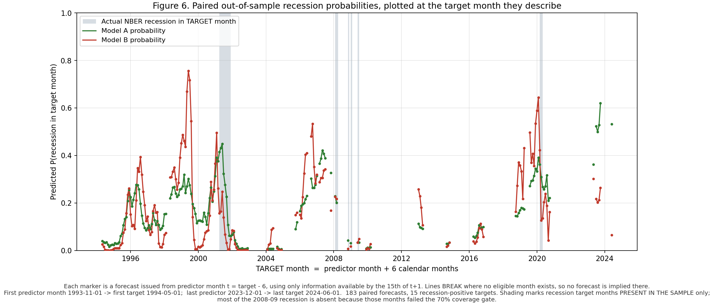
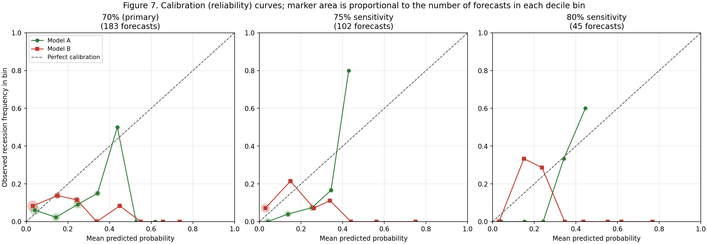
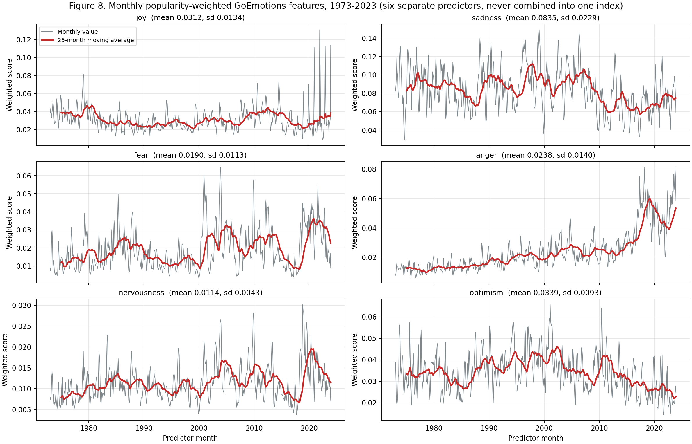
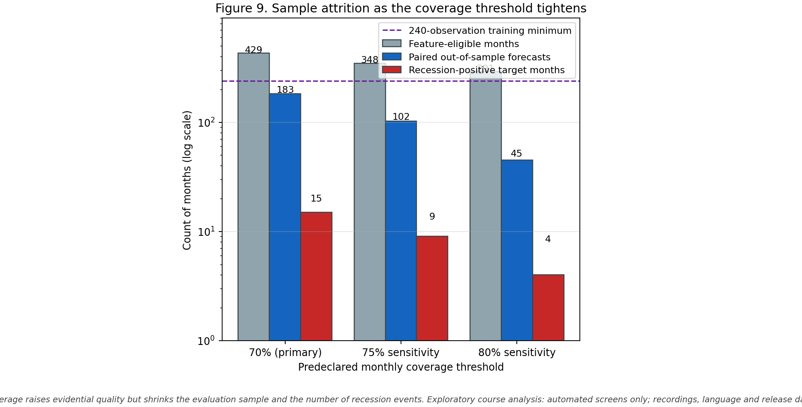
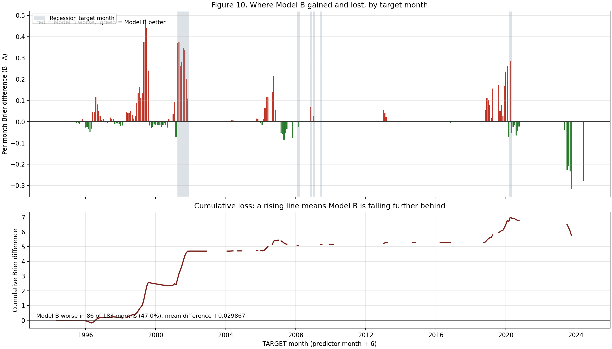

# Can Popular Music Predict U.S. Recessions?

**Complete research and engineering report**

NYU Courant · Predictive Analytics · Fall 2026 · Team 5
Keefer Wu · Nathan Starkman · Kiran Reddy Bhumireddy

> **Read this first.** The headline experiment is **complete**. Its results come from an
> explicitly labelled **exploratory course analysis**, not from a verified-evidence
> research design. The lyric records used passed only *automated* risk and
> English-language screens: no recording is independently verified, no language is
> human-reviewed, and no release date is verified. Source use rests on **reported
> instructor guidance for a course project**, which is documented as such and is
> **not** a copyright licence, a fair-use determination, or institutional approval.
> The separate strict policy is unchanged and still yields zero eligible records.

---

## Table of contents

1. [Executive summary](#1-executive-summary)
2. [Research motivation and hypotheses](#2-research-motivation-and-hypotheses)
3. [Project history and development timeline](#3-project-history-and-development-timeline)
4. [Complete data documentation](#4-complete-data-documentation)
5. [Data processing, with a worked example](#5-data-processing-with-a-worked-example)
6. [GoEmotions methodology](#6-goemotions-methodology)
7. [Model A in detail](#7-model-a-in-detail)
8. [Model B in detail](#8-model-b-in-detail)
9. [Evaluation methodology](#9-evaluation-methodology)
10. [Actual results](#10-actual-results)
11. [Figures and visualisations](#11-figures-and-visualisations)
12. [Error analysis](#12-error-analysis)
13. [Dataset bias and limitations](#13-dataset-bias-and-limitations)
14. [Reproducibility and exact commands](#14-reproducibility-and-exact-commands)
15. [Code provenance and reproducibility caveat](#15-code-provenance-and-reproducibility-caveat)
16. [What we tried that did not work](#16-what-we-tried-that-did-not-work)
17. [Improvements and future experiments](#17-improvements-and-future-experiments)
18. [Final conclusion](#18-final-conclusion)

---

## 1. Executive summary

### The research question

> Do popularity-weighted emotions in popular-song lyrics improve out-of-sample
> forecasts of U.S. recession status six months ahead, compared with a
> yield-curve-only Probit model?

For a forecast formed with information available in month *t*, the target is
`Y_t = USREC_{t+6}`: whether the U.S. economy is classified as being in recession
six calendar months later. This is a **recession-status** target, not a prediction
that a new recession *begins* within six months.

### Why popular music might carry economic signal

Popular music is one of the few continuously sampled, high-frequency records of
mass cultural expression that reaches back decades with consistent measurement.
The Billboard Hot 100 is effectively a weekly popularity poll over commercial
music. If collective mood shifts ahead of measurable economic deterioration — if
people buy and stream sadder or more anxious songs as uncertainty rises before it
shows up in hard data — then lyric emotion could in principle lead conventional
indicators. This is the intuition behind Zullow (1991) and, more recently,
Foramitti et al. (2025), whose corpus we use.

The weaker form of this idea is well supported: music consumption *co-varies* with
economic conditions. The stronger form, which is what matters for forecasting, is
that lyric emotion carries **incremental out-of-sample predictive information**
beyond what standard financial indicators already provide. Those are different
claims, and this project tests the second.

### Why the yield curve is the benchmark

The 10-year-minus-3-month Treasury spread is the standard reference for recession
prediction at horizons of roughly 6 to 18 months, established by Estrella &
Mishkin (1998). An alternative-data signal only earns a place in a forecasting
model if it improves on that baseline. Comparing music against a trivial
benchmark, or against no benchmark, would not be informative.

### What we implemented

Two Probit models, estimated on **identical** training rows and scored on
**identical** forecast dates:

- **Model A** — yield spread only: `P(Y_t = 1) = Φ(β₀ + β₁·Spread_t)`
- **Model B** — yield spread plus six monthly lyric-emotion features:
  joy, sadness, fear, anger, nervousness, optimism

Both use a six-calendar-month horizon, expanding-window estimation, a minimum of
240 eligible training observations, an information cutoff on the 15th of *t+1*,
and training targets restricted to *t−1* or earlier. Model B standardises its
features using training rows only.

### What the experiment found

We scored **16,290 songs** with real GoEmotions inference and ran the paired
comparison at three predeclared coverage thresholds.

| Coverage | Paired forecasts | Recession months | Model A Brier | Model B Brier | B − A | A ROC-AUC | B ROC-AUC |
|---|---|---|---|---|---|---|---|
| **70% (primary)** | **183** | **15** | **0.0903818731** | **0.1202485779** | **+0.0298667048** | **0.6462** | **0.4306** |
| 75% (sensitivity) | 102 | 9 | 0.0739858409 | 0.1146495991 | +0.0406637582 | 0.8722 | 0.5424 |
| 80% (sensitivity) | 45 | 4 | 0.0640448014 | 0.1206001394 | +0.0565553380 | 0.9878 | 0.7012 |

Brier is a loss, so a **positive difference means Model B is worse**. Zero fit
failures occurred in any run.

**Adding lyric emotions made six-month-ahead recession forecasts worse, not
better, at every threshold we predeclared.** Model B's primary ROC-AUC of 0.4306
is below 0.5, meaning worse-than-chance ranking on this sample. The direction of
the result is consistent across all three thresholds and the paired bootstrap
interval on the primary Brier difference, [+0.0147, +0.0458], excludes zero.

The failure is concentrated where it matters most: on the 15 recession-positive
target months, Model B's mean per-month Brier penalty is **+0.1713**, versus
+0.0172 on the 168 non-recession months. Model B misses recessions and raises
false alarms, while being slightly better than Model A in a bare majority of
quiet months (97 of 183).

### Main limitations and conclusion

Only **three recession episodes** (2001, 2008–09, 2020) are reachable, because the
corpus begins in 1973 and 240 training observations are required. Lyric coverage
declines monotonically after the 1980s (median 0.924 in the 1980s to 0.608 in the
2020s), so coverage drift is confounded with any emotion effect. GoEmotions is
Reddit-trained and applied out of domain. Seven predictors are fitted against
46–61 positive training labels.

Under this exploratory design and these samples, **lyric emotions did not improve
six-month-ahead U.S. recession forecasting relative to the yield-spread
baseline.** That is a genuine and reportable null-to-negative result. It is *not*
evidence that music contains no economic information in general — the design,
coverage, emotion model and event count are all too limited to support a claim
that broad.

---

## 2. Research motivation and hypotheses

### Alternative data in predictive analytics

"Alternative data" refers to inputs outside the conventional macroeconomic and
financial release calendar: satellite imagery, card transactions, job postings,
search volume, social media. Its appeal in forecasting is **timeliness** and
**orthogonality** — a signal that is available sooner than official statistics, or
that captures something official statistics miss, can add value even when it is
individually noisy.

The discipline's hard lesson is that most alternative data fails one of three
tests: it is not actually available earlier than the benchmark, it is not actually
orthogonal to cheaper signals, or its apparent historical relationship does not
survive honest out-of-sample evaluation. Our study is a direct test of the third.

### Popular music as a proxy for collective sentiment

Lyrics are an unusually attractive cultural time series. They are text, so modern
NLP applies. Chart data gives an explicit popularity weight, so we can measure
what people actually consumed rather than what was merely released. And the
Billboard Hot 100 has been published weekly with stable methodology for decades,
which is rare for cultural data.

Foramitti et al. (2025) report that, across 1973–2023 Billboard lyrics, sentiment
became more negative and lyrical complexity declined, with high-stress language
coinciding with increased complexity. Notably, they found **no significant
relationship between income growth and lyric stress**. Their framing is
descriptive and contemporaneous, which is the appropriate reading of that kind of
evidence.

### Historical association versus out-of-sample predictive value

This distinction is the methodological core of the project.

An in-sample association — "sad songs were more popular during recessions" — can
be real and still be useless for forecasting. It may be *contemporaneous* rather
than leading; it may reflect reverse causation, where recessions change music
rather than music anticipating recessions; and it will typically shrink or vanish
once you require the model to be estimated only on information available before
the forecast date.

We therefore committed from the outset to a strictly chronological,
expanding-window, paired evaluation on identical dates. Any improvement had to
show up in out-of-sample Brier score against a serious benchmark, not in
regression coefficients fitted to the whole sample.

### Why the yield spread

The term spread is the canonical recession predictor: theoretically motivated,
reported in real time, revision-free in its published form, and a strong empirical
performer at our exact horizon. Our Model A reference backtest over 630 forecasts
(October 1973 – March 2026) achieved a Brier score of 0.094921 and ROC-AUC of
0.720204, confirming it is a genuinely competitive benchmark rather than a
strawman.

### Our hypotheses, stated as hypotheses

These were our research hypotheses before the experiment. **None of them is a
verified finding.** Section 10 reports what we actually observed.

- **H1.** Popularity-weighted lyric emotions carry information about near-future
  economic conditions beyond the yield spread.
- **H2.** Negative-valence emotions (sadness, fear, anger, nervousness) rise, and
  positive-valence emotions (joy, optimism) fall, ahead of recessions.
- **H3.** Six separate emotion features will outperform a single collapsed
  sentiment index, because distinct emotions may carry distinct information.

We retained H3's design choice — six separate predictors — throughout. In
hindsight that choice interacts badly with our small event count, as Section 13
discusses.

---

## 3. Project history and development timeline

This section reconstructs the actual development process from committed code,
configuration, generated reports and documentation in this repository. Where the
record is incomplete we say so rather than filling gaps.

### 3.1 Original Model A implementation

**Goal.** Build a defensible economic baseline before touching music data.

**Work.** `src/music_recession/economic.py` builds the monthly economic table from
local FRED snapshots (`fredgraph.csv`, `GS10.csv`), validating monthly calendars,
cross-file `GS10` equality, and computing `spread_t = GS10_t − TB3MS_t` with
`USREC` looked up exactly six calendar months ahead. Output:
`data/processed/economic_monthly.csv`, 876 rows, predictor months April 1953 –
March 2026. `src/music_recession/baseline.py` implements the Probit with explicit
failure policy; `src/music_recession/backtest.py` runs the expanding window.

**Result.** 630 of 630 forecasts succeeded with no warnings. Brier 0.094921,
ROC-AUC 0.720204, log loss 0.338149, Brier Skill Score 0.068221 against an
expanding-training-prevalence reference. Training grew from 240 to 869
observations.

**What we learned.** The protocol in `docs/forecast_protocol.md` had to be fixed
*before* any music work, because the comparison's validity depends entirely on
both models sharing the same timing contract. The first eligible predictor month
is October 1973, since September 1973 has only 239 eligible observations.

### 3.2 Billboard dataset preparation

**Goal.** Establish the study universe independently of lyric availability.

**Work.** `billboard_hot100_all.csv` holds weekly Hot 100 observations;
`merge_billboard_data.py` assembled it. The 1973–2023 window yields **21,542
distinct song identities** and 13,438,037 total popularity weight.

**Key decision.** The universe is defined by the *charts*, not by which songs we
can find lyrics for. Every chart observation stays in the coverage denominator
even when lyrics are missing. Without this, missing data would silently inflate
apparent coverage.

### 3.3 Initial lyric-source exploration

**Goal.** Find a lyrics corpus with adequate historical coverage and defensible
provenance.

**Work.** `config/lyrics_sources.json` records the source registry with review
dates and explicit policy language. Candidates investigated: the OSF research
dataset, a Kaggle top-100 collection, LYDIA, tmelo-uea, and a LyricsFreak/songdata
listing.

**Problems.** Year-end hit lists are *lookup catalogues*, not valid substitutes for
weekly charts — selecting songs by their eventual year-end rank would leak future
chart behaviour into earlier forecasts. Several sources' licence labels (MIT, CC0)
describe the *compilation*, not the underlying lyrics. The LyricsFreak source
returned HTTP 403 and its licence could not be verified from the original source.

**Learning.** Repository licence labels do not settle lyric rights. This
realisation shaped every later policy decision.

### 3.4 OSF corpus selection

**Goal.** Choose a primary source whose records can be reconciled against chart
slots.

**Work.** The OSF project [2k7ut](https://osf.io/2k7ut/), associated with
[Foramitti et al. (2025)](https://www.nature.com/articles/s41598-025-28327-5),
was selected. Provenance was verified: the local
`data/raw/lyrics/osf_lyrics.csv` is byte-identical to the published file version 1
(1,256,141,520 bytes, SHA-256
`7820fd555b22a56a33dd128790e5c6d5414d4706919c02340a00d74213e1cc88`).

**Why OSF.** Alone among the candidates it carries weekly chart dates and ranks,
so each lyric record can be reconciled to a specific chart slot rather than merely
to a title/artist string.

**Caveat found.** The OSF project declares CC BY 4.0 while the associated article
is CC BY-NC-ND 4.0, and the project's copyright-holder field is empty. Neither
licence establishes the depositors' authority over third-party lyric text.

### 3.5 Kaggle, LYDIA, LRCLIB and NetEase investigation

**Goal.** Fill coverage gaps left by OSF.

**Work.** Alias and matching tables were built for Kaggle
(`config/kaggle_artist_aliases.csv`, `config/kaggle_additional_aliases.csv`),
LYDIA (`config/lydia_matched_song_sources.csv`,
`config/lydia_combined_singles_sources.csv`) and tmelo
(`config/tmelo_matched_song_sources.csv`). A recovery pipeline
(`scripts/recover_billboard_lyrics.py`) searched LRCLIB and NetEase, producing
`reports/lyrics_api_recovery.csv` and `reports/lyrics_netease_recovery.csv`.

**Result.** 812 LRCLIB and 113 NetEase candidate files, 925 total; 616 promising
automated metadata matches, 189 needing review, 120 high-risk; 600 of the 616 passed
preliminary text-quality screening.

**Problem.** None of these are approved or independently verified recordings, and
their rights position is no clearer than OSF's. Two tmelo yearly files (2012, 2015)
failed field/rank structure checks, so all 328 parsed records from them were
quarantined rather than guessed at.

**Decision.** OSF remained the primary source; supplementary sources were retained
as lookup catalogues and review queues only.

### 3.6 Song matching and the unresolved-lyrics tracker

**Goal.** Make the remaining gap explicit and shareable with teammates.

**Work.** `reports/missing_song_links_1973_2023.csv` (committed) tracks
**632 unresolved songs** in the recovery queue plus **12 separate earlier audit
exceptions**. Matching normalisation uses NFKC, case folding and punctuation
normalisation, but deliberately *retains* accents, word order, featured
contributors and mix/live/remaster qualifiers; only feat/ft/featuring markers are
harmonised. No fuzzy title-only acceptance, collaborator deletion or cover merging
is performed.

**Learning.** Punctuation normalisation alone can collide distinct songs, so every
resulting match stays provisional.

### 3.7 Recording-identity and quality audits

**Goal.** Determine what the local files actually support.

**Work.** `src/music_recession/lyrics_audit.py` performs an offline audit writing
`inventory_audited.csv`, `source_references.csv`, `mapping_issues.csv`,
`manual_review.csv`, `monthly_coverage.csv`, `summary.json` and `manifest.json`
into `reports/lyrics_validation/run_002/`. It records exact locators — file, ZIP
member, 1-based CSV record number — and the SHA-256 of the original decoded lyric
field, without exporting any lyric text.

**Findings.** Known error pages, missing/short/overlong text, instrumental markers
and mismatched OSF chart slots are excluded from "usable text". Instrumentals are
flagged and excluded rather than assigned six zero scores, because a zero vector
is a substantive and false emotional claim. Concurrent same-title collisions
(including *Unchained Melody*) are retained at every chart rank rather than merged.

**Learning.** `run_001` was retained as an audit trail: it predated whole-file
quarantine and the recognition of a legacy whitespace-trimmed hash convention.

### 3.8 OSF evidence screening

**Goal.** Quantify, per candidate, what the automated evidence actually
establishes.

**Work.** `scripts/audit_osf_evidence.py` produced
`reports/osf_source_review/run_004/candidate_evidence.csv` (19,096 rows, 43
columns) separating evidence axes: metadata/chart-slot match, chart observability,
language screen, version and featured-credit risk, instrumental status, plus
policy flags for recording/language/release/permission.

**Findings.** 19,096 candidates matched Billboard metadata and chart slots; 18,689
were classified consistently English; **16,290 passed the full automated screen**
(78.00% of chart popularity weight), leaving 2,806 flagged. The published
lyrics.ovh lookup strips featured-artist credits, affecting **2,309** candidates.
First Billboard appearance establishes chart *observability*, not verified release
date.

**Learning.** At the then-current 90% coverage threshold only **130 months**
qualified — far short of what a 240-observation training requirement needs.

### 3.9 Monthly coverage feasibility analysis

**Goal.** Choose an eligibility policy *without* looking at model performance.

**Work.** `scripts/measure_model_b_readiness.py` wrote
`reports/model_b_readiness/run_002/` with per-threshold coverage, blocking axes
and monthly scenarios. The script never imports the estimator and never reads
predictions, so a policy could not be chosen by peeking at Brier scores.

**Findings (unflagged subset).**

| Threshold | Qualifying months | Attainable forecasts |
|---|---|---|
| 70% | 433 | 183 |
| 75% | 352 | 102 |
| 80% | 295 | 45 |
| 85% | 222 | 0 |
| 90% | 130 | 0 |

Decade medians exposed the coverage drift: 1980s 0.924, 2000s 0.710, 2010s 0.659,
2020s 0.608. Including the reviewable flagged records would lift the 2000s to
0.921 and 2010s to 0.923 — direct evidence that the featured-credit flag, not
genuine absence, drives most of the modern gap.

**Decision.** 70% predeclared primary, 75% and 80% sensitivity. Also established:
the reachable evaluation window can contain at most **28 recession months across
3 episodes**, a ceiling no threshold choice can raise.

### 3.10 MusicBrainz metadata-matching pilot

**Goal.** Test whether the 2,309 featured-credit records could be cheaply
recovered.

**Work.** A 40-record pilot (20 by popularity weight, 20 spread across decades,
both reproducibly selected) queried MusicBrainz with the *reduced* query the
upstream lookup actually issued.

**Problems found, in our own classifier.** Three iterations were needed.
Compilation/reissue dates were being read as original release dates, manufacturing
four false "contradicted" verdicts; bare prefix matching conflated different songs
("Magic" vs "Magic Number"); and guest credits recorded in the recording *title*
were discarded by an exact-title filter. A fourth defect was the score floor: the
correctly credited recordings score **81–84**, not ≥90, because MusicBrainz lowers
the score when the query artist is only part of the credit — exactly the
featured-credit case.

**Result after fixes.** 18 of 40 metadata-corroborated, 22 ambiguous, 0
conflicting. Weight concentration was encouraging: reviewing the top 322 records
by popularity weight would recover 50% of flagged weight.

### 3.11 Independent validation pilot

**Goal.** Measure the frozen classifier out-of-sample rather than on the records it
was tuned against.

**Work.** Configuration was frozen and hashed *before* testing
(`DEFAULT_MIN_SCORE=75`, `DIVERGENT_YEAR_SPAN=5`, six blocking flags). A fresh 40
records were drawn from the remaining 2,215, with zero overlap asserted in code.

**Result.** 22 corroborated, 14 ambiguous, 1 conflicting, 3 no-match. The priority
stratum reproduced exactly (10/20 both times). Post-test hashes were identical to
pre-test, proving no tuning occurred.

**Honest findings from manual inspection of 10 cases.** The single
`conflicting_metadata` verdict (*Careless Whisper*) was a **false positive** —
MusicBrainz's returned releases were 1991–2024 pressings with the 1984 original
absent, and the corroborating credit came from a malformed string,
`'C. Vadi (Wham! feat. George Michael)'`. The three `no_match` cases were a query
defect: Billboard's soundtrack parentheticals (`Gangsta's Paradise (From "Dangerous
Minds")`) are chart formatting, not recording titles. One genuine success:
*Whats Poppin* was correctly flagged ambiguous because MusicBrainz holds the solo
original while Billboard's credit describes the charting remix — precisely the harm
the featured-credit flag exists to catch.

**Decision.** Reliable enough for triage, not for asserting identity. The full
2,255-record screen was costed (~2,420 API calls, ~81 minutes, ~481 MB cache) but
**deliberately not run**, because the priority changed to finishing the core
experiment.

### 3.12 Synthetic end-to-end pipeline validation

**Goal.** Prove the modelling machinery was correct before spending an hour of
inference on it.

**Work.** `tests/test_integration_model_comparison.py` exercises the full paired
path on invented economic series, invented labels and invented emotion scores from
a seeded RNG, with 300 synthetic months.

**Result.** 54 paired synthetic forecasts, zero fit failures. Verified: six emotion
features; popularity weighting proven by construction (60/40 weights whose vectors
straddle the intended value, so a plain mean provably cannot reproduce it);
six-calendar-month alignment; expanding windows from the 240 minimum; identical
dates for both models; training-only standardisation checked by recomputing each
window's means from training rows alone; no leakage asserted as
`training_target_end ≤ t−1` and `training_end < t`; probabilities in [0,1]; Brier
against a manual recomputation; and all output artefacts.

### 3.13 Real GoEmotions smoke test

**Goal.** Confirm the pretrained model loads and behaves sensibly before the full
run.

**Work.** Installed the declared `[music]` extra (torch 2.8.0, transformers 4.46.3,
safetensors 0.7.0) and downloaded the pinned revision.

**Bug found immediately.** `tokenizer.prepare_for_model` returns unbatched 1-D
tensors, so RoBERTa's forward raised
`ValueError: not enough values to unpack (expected 2, got 1)`. This code path had
**never executed** because no song had ever been eligible. Fixed by adding the
batch axis.

**Result after fix.** Sane, interpretable scores on invented sentences: joy 0.857
("woke up smiling"), anger 0.805 ("so angry I could shout"), optimism 0.666
("everything will work out"), fear 0.126 / nervousness 0.121 ("letters keep
coming, cannot sleep about money"). Deterministic on repeat. Throughput
0.09–0.13 s per lyric-sized text.

### 3.14 The actual 16,290-song inference run

**Goal.** Produce real monthly emotion features.

**Work.** A new, explicitly labelled exploratory policy
(`config/music_preparation_exploratory.json`,
`scripts/run_exploratory_comparison.py`) admits automatically screened records
while refusing to assert verification. Measured rate 5.07 songs/sec.

**Result.** All **16,290** eligible songs scored, 612 of 612 months receiving
features, 429 months feature-eligible at 70%.

**Problem encountered.** A second bug: manifest paths were resolved inconsistently
and raised on `relative_to`. Fixed.

### 3.15–3.16 The 70% primary and 75% / 80% sensitivity comparisons

**Result.** All three runs completed with `status: complete` and zero fit failures.
The sensitivity runs reused the cache at **100% hit rate**, confirming the
content-hash caching and resumption design worked. Full numbers in Section 10.

### 3.17 Reproducibility checks, bug fixes and final reporting

**Work and problems.** Fixing the synthetic-backend compatibility of the batching
guard changed `emotions.py`'s hash, which is embedded in the emotion cache key,
invalidating all 16,290 cached scores. A re-run was started and then **stopped at
45%** as an unnecessary hour of recomputation.

**How we resolved it without recomputing.** Because the partial re-run had scored
7,490 songs under the committed hash, and the original entries were still cached
under the old hash, the two sets could be compared directly:
**7,490 of 7,490 bit-identical, maximum absolute difference 0.0**, identical token
and chunk counts. Section 15 gives the full provenance position.

**Also in this phase.** An earlier step had corrected a separate protocol
question: a readiness test expected 54 attainable forecasts where the code produced
57. Independent date derivation established that **57 is correct** — the 54 figure
arises from treating the six-month horizon as six *eligible observations* rather
than six *calendar months*, which differ when eligible months alternate. The same
rule reproduces the protocol's documented October 1973 anchor, confirming it.

**Two unexplained tooling anomalies** are recorded for transparency: a shell
command returned with an `rm -rf reports/...` fragment spliced into it that was
never authored and never executed, and later approximately 180 files were found
staged in git without any `git add` having been issued for them. Both were caught
and neither affected results; the staged files were unstaged and curated
deliberately.

---

## 4. Complete data documentation

### 4.1 Billboard weekly Hot 100

| Property | Value |
|---|---|
| File | `billboard_hot100_all.csv` (tracked) |
| Source | [Historical weekly Billboard archive](https://github.com/mhollingshead/billboard-hot-100) |
| Fields used | chart date, song, artist, `this_week` rank |
| Study window | 1973-01-01 to 2023-12-31 |
| Distinct song identities | **21,542** |
| Total popularity weight | 13,438,037 |
| Monthly rows produced | 612 |

Validation refuses invalid ranks and duplicate `(date, rank)` slots. Months are
conservatively marked incomplete when fewer than four chart dates appear or
issue-date gaps exceed 8 days; the primary run found **0 incomplete months** and
only 4 months with missing rank slots.

### 4.2 Study universe: 1973–2023

The window matches the OSF corpus. The original proposal extended to 1959–2023;
1959–1972 is handled separately and is **not** part of this analysis. The universe
is defined by charts, not lyric availability.

### 4.3 Economic data

| Series | Source | Role |
|---|---|---|
| `GS10` | [FRED GS10](https://fred.stlouisfed.org/series/GS10) | 10-year Treasury yield |
| `TB3MS` | [FRED TB3MS](https://fred.stlouisfed.org/series/TB3MS) | 3-month Treasury bill |
| `USREC` | [FRED USREC](https://fred.stlouisfed.org/series/USREC) | NBER-based recession indicator |

Derived table: `data/processed/economic_monthly.csv`, 876 rows, predictor months
April 1953 – March 2026. `USREC_t` is retained for reference and must never enter
the model as a feature.

### 4.4 The OSF lyrics dataset

| Property | Value |
|---|---|
| Project | [OSF 2k7ut](https://osf.io/2k7ut/) |
| Paper | [Foramitti et al. (2025), *Scientific Reports*](https://www.nature.com/articles/s41598-025-28327-5) |
| Local file | `data/raw/lyrics/osf_lyrics.csv` (gitignored) |
| Size | 1,256,141,520 bytes |
| SHA-256 | `7820fd555b22a56a33dd128790e5c6d5414d4706919c02340a00d74213e1cc88` |
| Verification | Byte-identical to published file version 1, deposited 2025-05-20 |
| Project licence | CC BY 4.0 (copyright-holder field empty) |
| Article licence | CC BY-NC-ND 4.0 |

The upstream collection used title/artist queries to lyrics.ovh and Genius, and
the paper reports 20,186 English lyrics after exclusions. A 20,186 versus 20,187
count discrepancy against non-empty file identities remains unreconciled.

### 4.5 Candidate funnel

| Stage | Count |
|---|---|
| Billboard identities, 1973–2023 | 21,542 |
| Identities never reaching candidate selection | 2,446 |
| **OSF candidates selected** | **19,096** |
| Classified consistently English (automated) | 18,689 |
| **Passing the full automated screen** | **16,290** |
| Flagged, requiring review | 2,806 |

Weight shares: selected candidates carry 12,350,366 of 13,438,037 total weight
(91.9%); the unflagged 16,290 carry 10,481,530, i.e. **78.00%** of all chart
popularity weight.

### 4.6 Why 2,806 records were flagged

| Flag | Records |
|---|---|
| Featured-artist credit removed by upstream query (`upstream_credit_query_reduced`) | **2,309** |
| Version-specific title qualifier (`version_terms`) | 107 |
| Both flags on the same record | 19 |
| **Distinct union of the two reviewable flags** | **2,397** |
| Reviewable-only (flags confined to those two kinds) | 2,340 |
| Mixed or non-English block | 234 |
| Language uncertain | 104 |
| Non-English likely | 50 |

Credit-flagged records carry 1,561,653 observable weight — **11.62%** of all chart
weight — so this single flag accounts for most of the modern coverage gap.

### 4.7 Language and recording-identity concerns

The language screen is automated `langid`-style classification, not review.
Non-Latin script raises an additional flag but does not identify a language, and
Latin-script Spanish or multilingual lyrics may not trigger it. No translation or
language filtering is performed.

For recording identity, the upstream title/artist lookup **cannot establish exact
recording identity**. Our MusicBrainz pilots demonstrated the concrete risk:
*Whats Poppin* charted as a remix with three guests, while the metadata source
holds the solo original — the reduced query would return the wrong recording's
lyrics. First Billboard appearance establishes chart **observability**, not a
verified release date.

### 4.8 Copyright and source-use limitations

**Public accessibility does not imply permission.** A dataset can be lawfully
downloadable while the underlying song lyrics remain third-party copyrighted
works. Three distinct things are often conflated:

1. **Access** — can the file be obtained?
2. **Compilation licence** — what terms did the depositor attach to *their*
   compilation? CC BY 4.0 here covers only rights the depositor actually controls.
3. **Underlying rights** — do the lyric authors' and publishers' rights permit this
   use? Creative Commons' own notice states a CC licence may not supply all
   necessary permissions.

Repository labels such as MIT or CC0 on lyric collections describe the
compilation, not the lyrics. A README asserting fair use is a publisher's
statement, not verified rightsholder permission.

Our operating rules: never commit raw lyric text; keep raw corpora under the
gitignored `data/raw/lyrics/`; export only metadata, hashes and aggregate
statistics; never redistribute lyrics.

### 4.9 Reported instructor guidance

The team reports that their instructor said lyrics may be downloaded and analysed
for this course project. This is recorded as **reported instructor guidance for a
course project**, implemented as the configuration value
`"source_use_basis": "reported_instructor_guidance_course_project_not_a_license"`
and written verbatim into every output manifest.

It is explicitly **not** a copyright licence, a fair-use determination, NYU legal
or Open Knowledge approval, or verification of any recording, language or release
date. The five outstanding decision questions in `docs/osf_source_use_review.md`
remain open.

### 4.10 Strict policy versus exploratory course policy

| Axis | Strict primary policy | Exploratory course policy |
|---|---|---|
| Config | `config/music_preparation.json` | `config/music_preparation_exploratory.json` |
| Coverage threshold | 0.90 | 0.70 primary (0.75, 0.80 sensitivity) |
| Eligibility route | Per-song human review record | Automated risk + English screens |
| `recording_verified` | Must be `True` | **Must be `False`** |
| `release_date` | Validated ISO date required | **Must be empty** |
| Language | `reviewed_english_only` | `automated_screen_english_unreviewed` |
| Rights basis | `required_for_nlp` | `reported_instructor_guidance_exploratory_not_verified` |
| Eligible records | **0** | 16,290 |

The exploratory path is **not** a relaxation of the strict gate; it is a separate
gate with **inverted** invariants. `require_exploratory_eligible` *refuses* any row
claiming a verified recording or asserting a release date, so the two cannot be
confused. The field `eligibility_basis` records which gate applied. Leaving
`release_date` empty is deliberate: `docs/osf_source_use_review.md` item 4 warns
against back-filling that field with a chart date, so the weaker basis is recorded
in `release_evidence` instead.

---

## 5. Data processing, with a worked example

### 5.1 The pipeline

```
Weekly Billboard chart observations   (date, song, artist, rank)
        │
        ▼  normalise title/artist, reconcile to chart slot
Song identity matching                (21,542 identities)
        │
        ▼  select one clean weekly OSF locator per identity
Lyrics source selection               (19,096 candidates)
        │
        ▼  automated risk + English screens
Automated screening                   (16,290 eligible)
        │
        ▼  GoEmotions, once per song, cached by content hash
Per-song emotion vectors              (6 scores in [0,1])
        │
        ▼  weight = 101 − rank, per weekly appearance
Monthly popularity weighting
        │
        ▼
Six monthly emotion features          (612 months)
        │
        ▼  join on calendar month t
Economic merge                        (spread_t, target_t = USREC_{t+6})
        │
        ▼  expanding window, ≥240 eligible training rows
Probit estimation                     (Model A and Model B)
        │
        ▼  identical dates, paired
Evaluation                            (Brier, ROC-AUC, calibration)
```

### 5.2 The popularity weight

Each weekly chart appearance *i* receives

```
w_i = 101 − r_i
```

where `r_i` is that week's rank. A #1 record contributes 100; a #100 record
contributes 1. The scheme is linear, fixed in advance, and chosen so that chart
position maps monotonically to influence without any tuned parameter.

### 5.3 The monthly aggregation

For emotion *k* and predictor month *t*:

```
            Σ_{i ∈ C_t, eligible}  w_i · e_{i,k}
E_{t,k}  =  ─────────────────────────────────────
            Σ_{i ∈ C_t, eligible}  w_i
```

where `C_t` is the set of weekly chart observations in month *t* that are known by
the forecast cutoff, and `e_{i,k}` is the song's score for emotion *k*.

**A song charting for several weeks contributes once per weekly appearance**, each
with its own rank weight. This is intentional: a song that spends six weeks at #1
shaped that month's listening more than a song that spent one week at #90.

### 5.4 Coverage uses a different denominator

Coverage deliberately divides by **all** observed chart weight, including songs
with no usable lyrics:

```
                     Σ_{i ∈ C_t, eligible} w_i
coverage_t  =  ──────────────────────────────────────
               Σ_{i ∈ C_t, all observations} w_i
```

The feature mean (5.3) divides by eligible weight, because averaging over missing
songs would require inventing their scores. Coverage divides by *total* weight,
because the honest question is "how much of what people actually listened to did
we measure?" Using eligible weight in both places would make coverage always
appear to be 100%.

### 5.5 Worked example (hypothetical numbers)

Suppose a hypothetical month contains exactly three weekly chart observations.

| Observation | Song | Rank | `w = 101 − rank` | Lyrics eligible? | joy score |
|---|---|---|---|---|---|
| 1 | Song X, week 1 | 1 | 100 | yes | 0.60 |
| 2 | Song X, week 2 | 3 | 98 | yes | 0.60 |
| 3 | Song Y, week 1 | 50 | 51 | **no** | — |

Song X appears twice and therefore contributes twice, with weights 100 and 98.
Song Y has no usable lyrics, so it contributes to the coverage denominator only.

**Eligible weight** = 100 + 98 = 198
**Total observed weight** = 100 + 98 + 51 = 249

Monthly joy feature:

```
E_joy = (100 × 0.60 + 98 × 0.60) / (100 + 98)
      = (60.0 + 58.8) / 198
      = 118.8 / 198
      = 0.600
```

Monthly coverage:

```
coverage = 198 / 249 = 0.7952  →  79.5%
```

At a 70% threshold this month qualifies; at 80% it does not. Note that Song Y's
absence does **not** pull the joy feature toward zero — it reduces coverage
instead. Had we instead scored Song Y as 0.0, the feature would have fallen to
`118.8 / 249 = 0.477`, a fabricated 20% drop in apparent joy caused purely by
missing data. Avoiding that artefact is why instrumentals are excluded rather than
assigned zero vectors.

### 5.6 Economic merge and target construction

The spread is `S_t = GS10_t − TB3MS_t`. Monthly features and the spread join on
calendar month *t*; the target is `Y_t = USREC_{t+6}`, looked up **by date**, never
by row offset, so year boundaries and gaps cannot silently shift the horizon. The
modelling table holds one row per forecast month.

---

## 6. GoEmotions methodology

### 6.1 The exact configured model

From `config/music_model.json`:

```json
{
  "model_id": "SamLowe/roberta-base-go_emotions",
  "revision": "d75048347613a25d77de8cf6412eaae9fa7b26be",
  "chunk_tokens": 480,
  "chunk_pooling": "token_weighted_mean_sigmoid",
  "device": "cpu",
  "emotions": ["joy", "sadness", "fear", "anger", "nervousness", "optimism"],
  "model_b_standardization": "training_only_population_std"
}
```

`validate_config` in `src/music_recession/emotions.py` **requires a full 40-hex
commit**, rejecting floating branch names such as `main`, so the model cannot
silently change under us. Execution is CPU-only, single-threaded, with
`torch.manual_seed(0)` and `torch.use_deterministic_algorithms(True)`.

Verified environment: torch 2.8.0, transformers 4.46.3, safetensors 0.7.0,
numpy 2.0.2, Python 3.9.6.

### 6.2 Trained on Reddit, applied to lyrics

GoEmotions ([Demszky et al., 2020](https://aclanthology.org/2020.acl-main.372/))
is annotated on **Reddit comments**: short, conversational, first-person, literal
text. Song lyrics are none of those. They are repetitive by design, use figurative
and metaphorical language, follow rhyme and metre constraints, and often adopt a
persona rather than expressing the writer's state. This is a genuine
**domain-transfer gap**, and it is unvalidated here. The planned manual review of
emotion predictions on a lyric sample was **not performed**.

### 6.3 The six emotions

Joy, sadness, fear, anger, nervousness, optimism — six **native** GoEmotions
labels, chosen before any recession outcome was inspected. The model is validated
at load time: it must expose all six labels and declare
`problem_type == "multi_label_classification"`, otherwise the run aborts.

Because the objective is multi-label with independent sigmoids, the six scores
**do not sum to 1**. Each is an independent probability that the label applies.

### 6.4 Tokenisation, chunking and pooling

Lyrics routinely exceed RoBERTa's 512-token limit. Rather than truncate — which
would silently discard later verses — the implementation chunks and pools:

1. Encode the full text without truncation and without special tokens.
2. Split into **non-overlapping** chunks of at most 480 content tokens.
3. Add special tokens per chunk and run each through the model.
4. Apply sigmoid to obtain per-chunk probabilities.
5. Pool as a **content-token-weighted mean**:

```
score_k = Σ_c  (n_c · p_{c,k})  /  Σ_c n_c
```

where `n_c` is chunk *c*'s content-token count. Special tokens carry no pooling
weight. A long final verse therefore influences the result in proportion to its
length rather than counting equally with a short one.

The relevant code is the `GoEmotions.__call__` method in
`src/music_recession/emotions.py`.

### 6.5 Caching and reproducibility

`cached_score` writes one JSON file per song keyed by the SHA-256 of a metadata
blob containing the song id, source reference id, **lyric content hash**, the full
model configuration, the **implementation hash of `emotions.py`**, and installed
package versions. Before use it re-verifies that the lyric content hash matches
the reviewed hash, so silently altered text cannot be scored.

Consequences, both intended and inconvenient:

- A song is scored **once**, no matter how many months or weeks it appears in.
- Interrupted runs resume for free; our sensitivity runs hit the cache at 100%.
- Caches store **scores only, never lyric text**.
- Any edit to `emotions.py` invalidates the entire cache. This bit us in
  Section 3.17.

### 6.6 Score once, aggregate afterwards

Emotion inference is a property of the **song**; popularity weighting is a property
of the **chart week**. Separating them means a song charting 20 weeks is scored
once and weighted 20 times. This is both far cheaper and more correct than scoring
per appearance, which would produce identical numbers at 20× the cost.

### 6.7 Instrumentals, language uncertainty and missing lyrics

- **Instrumentals** are flagged and **excluded** from lyric-text coverage. They are
  never assigned six zero scores, because a zero vector asserts "this song contains
  no joy, no sadness, …", which is a substantive false claim rather than a neutral
  default. The audit notes no complete instrumental classifier exists, so source
  instrumental booleans are treated as hints.
- **Language uncertainty** blocks eligibility under both policies
  (`unknown_languages: block_nlp`).
- **Missing lyrics** reduce monthly coverage and never contribute a fabricated
  value. Months whose coverage falls below the threshold are excluded entirely
  rather than imputed.

### 6.8 Why six separate variables

Collapsing to one scalar presumes a single valence axis explains the relevant
variation. Fear and anger are both negative but behave differently; nervousness is
anticipatory where sadness is reactive. Keeping six predictors preserves that
structure.

The cost is parameter count. Model B estimates 8 parameters against 46–61 positive
training labels, giving events-per-variable of roughly 5.8–9.2 against a
conventional minimum near 10. Section 13 treats this as a leading candidate
explanation for the observed result, and Section 17 proposes a predeclared
single-index alternative.

### 6.9 Domain-transfer limitations, summarised

The measured monthly magnitudes are low — joy 0.031, sadness 0.084, nervousness
0.011 — which is what one expects from multi-label sigmoids applied out of domain.
`nervousness` is a weak pretrained label with the smallest mean and standard
deviation of the six. None of the six has been validated against human judgements
of lyric emotion in this project, so they should be read as **model outputs**, not
as measured emotions.

---

## 7. Model A in detail

### 7.1 The model

```
P(Recession at t+6 | information at t)  =  Φ(β₀ + β₁ · YieldSpread_t)
```

`Φ` is the standard normal CDF. Estimation is unregularised maximum likelihood via
Newton's method (`statsmodels` Probit), with no feature standardisation, no
penalisation and no fallback estimator.

### 7.2 Definitions

| Term | Definition |
|---|---|
| **GS10** | 10-year Treasury constant-maturity yield, monthly average, percent |
| **TB3MS** | 3-month Treasury bill secondary-market rate, monthly average, percent |
| **Yield spread** | `S_t = GS10_t − TB3MS_t`, percentage points. Negative = inverted curve |
| **Recession indicator** | `USREC`, NBER-based monthly binary from FRED |
| **Target** | `Y_t = USREC_{t+6}`, recession *status* six months later |
| **Horizon** | Exactly **six calendar months**, looked up by date |
| **Expanding window** | Training set grows forward; a fresh fit per forecast month |
| **Minimum training** | **240 eligible observations**, a count of rows, not a span |
| **Information cutoff** | 15th calendar day of month *t+1* |

### 7.3 The training-eligibility rule

A row *i* may train the forecast for month *t* when both hold:

1. `i ≥ training_start` (April 1953 for the reference backtest, January 1973 for
   the paired comparison), and
2. `target(i) = i + 6 months ≤ t − 1`.

The second condition is the no-lookahead guarantee: a training row's outcome must
have been observable before the forecast is issued. Eligibility is computed
**from dates**, never by dropping a fixed number of rows, and missing months are
never fabricated to reach 240.

This rule makes **October 1973** the first eligible predictor month for the
reference backtest: training predictors April 1953 – March 1973, targets October
1953 – September 1973, 240 rows with 37 recession labels. September 1973 has only
239 and is correctly refused.

### 7.4 A protocol subtlety worth recording

The horizon is six **calendar months**; the 240 is a count of **observations**.
These coincide only when eligible months are contiguous. When eligible months
alternate, six calendar months spans just three observations. A readiness test
initially expected 54 attainable forecasts where the implementation produced 57;
independent date derivation confirmed **57 is correct**, and that 54 results from
conflating the two units. The same rule reproduces the documented October 1973
anchor, which validates it against the protocol rather than against itself.

### 7.5 Reference backtest result

| Metric | Value |
|---|---|
| Forecasts | 630 of 630 succeeded |
| Predictor months | October 1973 – March 2026 |
| Brier score | **0.094921** |
| ROC-AUC | 0.720204 |
| Log loss | 0.338149 |
| Brier Skill Score | 0.068221 |
| Observed recession frequency | 11.11% (70 / 630) |

### 7.6 Why 0.094921 must not be compared with Model B

**This is the single most important methodological warning in the report.**

The 0.094921 figure comes from 630 forecasts spanning October 1973 – March 2026,
with training beginning in April 1953. Model B's primary evaluation has **183**
forecasts spanning November 1993 – December 2023, with training beginning in
January 1973, restricted to months clearing a 70% lyric-coverage gate.

Those are different samples, different periods, different event counts and
different base rates. Brier scores are **not** comparable across different
evaluation sets: a sample containing proportionally fewer or easier recession
months will produce a lower Brier score for reasons that have nothing to do with
model quality. The 80% run illustrates this starkly — Model A's Brier *falls* to
0.0640 and its AUC *rises* to 0.9878 purely because the sample shrank to 45
forecasts with 4 recession months.

We therefore **re-estimated and re-scored Model A on exactly Model B's dates** in
every comparison. Every Model A number in Section 10 is a fresh paired
computation. The 0.094921 figure appears in this report only as evidence that the
baseline is competitive in general, never as a comparison term.

---

## 8. Model B in detail

### 8.1 The model

```
P(Recession at t+6 | information at t) =
    Φ( β₀
     + β₁ · Spread_t
     + β₂ · Joy_t
     + β₃ · Sadness_t
     + β₄ · Fear_t
     + β₅ · Anger_t
     + β₆ · Nervousness_t
     + β₇ · Optimism_t )
```

Seven predictors plus an intercept: **8 estimated parameters**.

### 8.2 The six emotions form one vector, not one score

`E_t = (Joy_t, Sadness_t, Fear_t, Anger_t, Nervousness_t, Optimism_t)` is a
**six-dimensional monthly vector**. Each component enters with its own
coefficient. At no point are the six averaged, summed, differenced into a
valence score, or reduced by PCA. "Six separate emotion predictors" is a design
commitment, and `FEATURES = ['spread_t'] + EMOTIONS` in
`src/music_recession/music_model.py` encodes it.

### 8.3 Training-only standardisation

Within each expanding window, `_fit_extended` computes the mean and standard
deviation of all seven predictors **from the training rows of that window only**,
standardises, fits, then maps coefficients back to original units for reporting.

This matters for leakage. Standardising on the full sample would let the forecast
month's own feature values influence its scaling — a subtle but real leak. Our
integration test verifies the property directly by recomputing each window's means
from the training rows and matching the reported `training_mean` to nine decimal
places, and by confirming the first and last windows' means differ.

Model A remains deliberately **unstandardised**, matching its original
specification.

### 8.4 Identical dates, identical targets

`evaluate` in `music_model.py` enforces pairing structurally rather than by
convention:

- One shared `features` dictionary keyed by predictor month.
- A validation pass raising if the economic spread or label differs between the
  two models for any month.
- A single `select_training(common_rows, t, paired_config)` call per month, whose
  result is handed to **both** `fit_probit` (Model A) and `fit_extended` (Model B).
- A single `training_months_sha256` recorded per forecast, so the training set is
  auditable.
- Metrics computed only over records with `status == 'ok'`, meaning **both** models
  fitted and predicted successfully.

Both models therefore see the same rows, the same labels and the same dates by
construction, not by care.

### 8.5 Forecast cutoff safeguards

Several independent guards prevent future information entering a forecast:

- Training targets must satisfy `target ≤ t − 1`.
- Weekly chart observations must fall **within** month *t* and be available by the
  15th of *t+1*; `eligible_observation` rejects adjacent-month observations even
  when they precede the cutoff.
- A source exemplar drawn from a later chart week cannot backfill an earlier month
  (`source_chart_reference_after_cutoff`).
- Under the strict policy, a verified release date later than the chart date
  excludes the contribution (`recording_release_after_chart`).
- Year-end chart membership is never used for selection, since it encodes future
  chart behaviour.

### 8.6 How missing coverage selects the sample

Coverage affects Model B twice over. A month needs coverage at or above the
threshold to be **feature-eligible**; and it needs 240 prior eligible observations
to be **forecastable**. Tightening the threshold therefore shrinks both the
training pool and the evaluation window simultaneously, which is why the 80% run
has only 45 forecasts and 4 recession months.

Critically, because coverage declines over time (Section 4.6, Section 13), the
surviving months are **not** a random subsample of the period. They skew early.

### 8.7 Why more predictors can hurt

Model B adds six predictors but **no new recession events**. With 8 parameters and
46–61 positive training labels, events-per-variable is roughly 5.8–9.2. Below
roughly 10, coefficient estimates become unstable and in-sample fit improvements
routinely fail to generalise.

The mechanism is variance, not bias: six additional weakly informative predictors
give the likelihood many directions in which to fit noise, and each fitted
direction adds forecast variance. Section 12 shows exactly this signature —
Model B is slightly better in a majority of quiet months but catastrophically
worse in a minority, especially during recessions.

---

## 9. Evaluation methodology

### 9.1 Brier score

The Brier score is the mean squared error of probabilistic forecasts:

```
BS = (1/N) · Σ_{t=1}^{N} (p̂_t − Y_t)²
```

where `p̂_t ∈ [0,1]` is the predicted probability and `Y_t ∈ {0,1}` the outcome.

**Lower is better.** It is a *loss*, so a positive `B − A` difference means Model B
is worse. The range is [0,1]; 0 is perfect. It is a **proper** scoring rule: it is
minimised in expectation by reporting your true believed probability, so it cannot
be gamed by shading forecasts toward the base rate.

Brier rewards both discrimination (ranking recessions above non-recessions) and
calibration (probabilities meaning what they say).

### 9.2 Worked Brier example

Four hypothetical forecasts:

| Month | Predicted `p̂` | Actual `Y` | `(p̂ − Y)²` |
|---|---|---|---|
| 1 | 0.10 | 0 | 0.0100 |
| 2 | 0.80 | 1 | 0.0400 |
| 3 | 0.60 | 0 | 0.3600 |
| 4 | 0.30 | 1 | 0.4900 |

```
BS = (0.0100 + 0.0400 + 0.3600 + 0.4900) / 4 = 0.9000 / 4 = 0.2250
```

Months 3 and 4 — a confident false alarm and a confident miss — dominate. This is
exactly the structure of Model B's failure in Section 12.

For orientation: always predicting the base rate of a series with 8% recession
months yields a Brier near 0.075, which is why our absolute values in the 0.06–0.12
range are unremarkable and only the **paired difference** is informative.

### 9.3 ROC-AUC

ROC-AUC is the probability that a randomly chosen recession month receives a
higher forecast than a randomly chosen non-recession month. 1.0 is perfect
ranking, 0.5 is chance, and **below 0.5 is worse than chance** — systematically
ranking recessions *below* quiet months.

AUC measures **ranking only** and is invariant to monotone transformations, so a
model can have excellent AUC and useless calibration. With 4–15 positive months
our AUC values are extremely unstable: a single reordered month moves them
materially. Compare AUC *within* a threshold, never across thresholds.

### 9.4 Calibration

Calibration asks whether a forecast of 30% is followed by recession about 30% of
the time. We bin forecasts into ten fixed deciles and compare mean predicted
probability against observed frequency per bin. A well-calibrated model lies on
the diagonal.

Calibration is the component of Brier that AUC ignores, and it is where Model B
fails most visibly.

### 9.5 Paired forecast comparison

Both models forecast the **same months** from the **same training rows** against
the **same labels**, so the per-month difference

```
d_t = (p̂^B_t − Y_t)² − (p̂^A_t − Y_t)²
```

is a clean within-month contrast. Sample difficulty, base rate and period effects
cancel, since both models face identical conditions. The mean of `d_t` is exactly
the reported Brier difference.

Unpaired comparison across different date sets would conflate model quality with
sample difficulty — the error Section 7.6 warns against.

### 9.6 Chronological evaluation versus random splits

Random train/test splitting is **invalid** here. It would place future months in
the training set for past forecasts, leak information through the serially
correlated spread, and allow a model to interpolate within a recession it has
partly seen. Expanding-window evaluation reproduces the real constraint: at each
date, use only what was knowable then.

### 9.7 Why naive bootstrap intervals mislead

Our primary paired bootstrap interval, resampling months independently, gives
[+0.0147, +0.0458], excluding zero. **That interval is too narrow**, for three
compounding reasons:

1. **Overlapping forecasts.** Consecutive months share almost all of their
   training data and target six-month windows that overlap, so `d_t` values are
   strongly serially dependent. Independent resampling assumes 183 independent
   observations where the effective number is far smaller.
2. **Few episodes.** The 15 recession months come from only three episodes. The
   effective sample for recession-related error is closer to 3 than 15.
3. **Clustered errors.** Section 12 shows the large differences cluster in
   specific periods (1999, 2001, 2023), exactly the structure an i.i.d. bootstrap
   mishandles.

A block bootstrap or a Diebold–Mariano test with HAC standard errors would be
appropriate; neither is implemented here. We therefore report the interval with
this caveat attached and lean on **consistency of sign across three thresholds**
as the more credible robustness evidence. Our naive paired *t* of +3.74 should be
read the same way.

---

## 10. Actual results

Every number below is read directly from the saved `metrics.json` files under
`reports/model_comparison/`. A machine-readable copy is at
[`figures/music_recession/results_summary.json`](figures/music_recession/results_summary.json).

### 10.1 Primary analysis, 70% coverage

| Quantity | Value |
|---|---|
| Status | `complete` |
| Songs scored with real GoEmotions inference | **16,290** |
| Analysis months | 612 |
| Feature-eligible months | 429 |
| **Paired out-of-sample forecasts** | **183** |
| **Recession-positive target months** | **15** |
| Predictor window | 1993-11-01 → 2023-12-01 |
| Target window | 1994-05-01 → 2024-06-01 |
| **Fit failures** | **0** |
| **Model A Brier** | **0.0903818731** |
| **Model B Brier** | **0.1202485779** |
| **Difference (B − A)** | **+0.0298667048** |
| **Model A ROC-AUC** | **0.6462301587** |
| **Model B ROC-AUC** | **0.4305555556** |

### 10.2 Sensitivity, 75% coverage

| Quantity | Value |
|---|---|
| Feature-eligible months | 348 |
| Paired forecasts | **102** |
| Recession-positive months | **9** |
| Predictor window | 1993-11-01 → 2020-02-01 |
| Target window | 1994-05-01 → 2020-08-01 |
| Fit failures | 0 |
| Model A Brier | 0.0739858409 |
| Model B Brier | 0.1146495991 |
| Difference (B − A) | +0.0406637582 |
| **Model A ROC-AUC** | **0.8721624851** |
| **Model B ROC-AUC** | **0.5424133811** |

### 10.3 Sensitivity, 80% coverage

| Quantity | Value |
|---|---|
| Feature-eligible months | 291 |
| Paired forecasts | **45** |
| Recession-positive months | **4** |
| Predictor window | 1994-05-01 → 2016-03-01 |
| Target window | 1994-11-01 → 2016-09-01 |
| Fit failures | 0 |
| Model A Brier | 0.0640448014 |
| Model B Brier | 0.1206001394 |
| Difference (B − A) | +0.0565553380 |
| **Model A ROC-AUC** | **0.9878048780** |
| **Model B ROC-AUC** | **0.7012195122** |

The two sensitivity AUCs you asked us to verify are **0.8721624851 / 0.5424133811**
at 75% and **0.9878048780 / 0.7012195122** at 80%.

### 10.4 What each number means

- **Brier score** — mean squared forecast error. Model B's 0.1202 against Model
  A's 0.0904 at the primary threshold means Model B's probabilities sit about 33%
  further from the truth on average, over identical months.
- **Difference B − A** — the paired penalty. Positive at all three thresholds, and
  monotonically increasing as coverage tightens.
- **ROC-AUC** — ranking quality. Model B's 0.4306 is **below chance**: on this
  sample it ranked recession months *below* quiet months slightly more often than
  not. Model A's 0.6462 is modest but genuine.
- **Paired forecasts** — the shared evaluation months. Both models produced a
  probability for every one.
- **Recession-positive months** — the number of target months actually labelled
  recession. This is the binding constraint on precision: 15, 9 and 4.
- **Fit failures: 0** — every expanding-window Probit converged, for both models,
  at every threshold. The result is not an artefact of estimation failure.

### 10.5 Why the three thresholds must not be compared with each other

The three rows use **different samples**, so their absolute scores are not
commensurable. Model A's Brier *improves* from 0.0904 to 0.0640 and its AUC rises
from 0.6462 to 0.9878 as the threshold tightens — not because the model improved,
but because the sample shrank from 183 forecasts with 15 recession months to 45
forecasts with 4. Fewer, earlier, easier months produce better-looking scores for
both models.

The only legitimate cross-threshold reading is of the **paired difference**, which
holds sample effects constant within each row. That difference is positive in all
three rows, which is the robustness evidence. Its *growth* across rows
(+0.0299 → +0.0407 → +0.0566) should be read cautiously, since the samples
differ.

---

## 11. Figures and visualisations

All figures live in [`figures/music_recession/`](figures/music_recession/) and are
regenerated from already-computed outputs by
`scripts/make_research_figures.py`, which performs **no inference, no model
fitting and no network access**.

### Figure 1 — Analysis pipeline



**What it shows.** The ten pipeline stages in execution order, colour-coded into
data assembly and screening (blue), emotion feature construction (orange) and
econometric modelling (green), with the key counts at each narrowing step:
21,542 chart identities → 19,096 OSF candidates → 16,290 passing automated
screens.

**Interpretation.** The diagram makes the two separations that protect the study
visible. Emotion inference happens **per song** and is cached, while popularity
weighting happens **per weekly chart appearance** — stages 5 and 6 — which is why
16,290 inference calls can serve 612 months. And the economic merge (stage 8)
happens *after* feature construction, so no economic or recession information can
influence which songs or months are admitted.

**What cannot be concluded.** This is an architecture diagram, not evidence. The
counts describe funnel sizes, not data quality; "16,290 pass" means they passed
*automated* screens, not that they are verified recordings.

### Figure 2 — Coverage and eligibility by decade



**What it shows.** Left: median monthly popularity-weighted lyric coverage per
decade, against the 70% primary threshold. Right: calendar months per decade
versus months surviving the 70% gate.

**Interpretation.** This is the single most consequential data-quality finding in
the project. Coverage peaks in the 1980s at 0.924 and falls monotonically
thereafter to 0.608 in the 2020s. The right panel shows the consequence: the
1980s contribute all 120 months, the 1990s 118, but the 2010s only **33 of 120**
and the 2020s only **10 of 48**. The evaluation sample is therefore heavily
weighted toward earlier decades, and the mechanism is known — featured-artist
billing became common from the 1990s onward and the upstream lyrics.ovh lookup
stripped those credits, so modern collaborations fail the screen at much higher
rates.

**What cannot be concluded.** This does not show that modern lyrics are absent
from the corpus, only that they fail *our* screens. Section 3.9 established that
admitting the reviewable flagged records would lift 2000s coverage to 0.921 and
2010s to 0.923, which indicates a matching artefact rather than genuine absence.
It also does not establish that the coverage drift *caused* Model B's poor
performance — that remains a plausible explanation, not a measured effect.

### Figure 3 — Monthly coverage over time



**What it shows.** Month-by-month coverage across all 612 months, with the three
predeclared thresholds marked and eligible months highlighted.

**Interpretation.** The decline is gradual and persistent rather than a single
break, which argues against a one-off data problem and for a structural change in
how credits are written. 179 of 612 months fall below the 70% line, concentrated
after 2000. The green eligible markers thin out visibly from the mid-2000s. The
spread between the 70%, 75% and 80% lines explains the sample attrition in
Section 10: each additional five points of required coverage removes a large block
of later months.

**What cannot be concluded.** Coverage is a measure of *how much chart weight we
scored*, not of data correctness. A month at 0.95 coverage could still contain
wrongly matched recordings; coverage and accuracy are different axes.

### Figure 4 — Brier score comparison



**What it shows.** Paired Brier scores for both models at each threshold, with the
B − A difference annotated.

**Interpretation.** The core result. Model B (red) is worse than Model A (green)
at every threshold, and the gap widens as coverage tightens: +0.0299, +0.0407,
+0.0566. Because each pair comes from identical months with identical training
rows, the within-pair comparison is clean. The consistency of sign across three
independently predeclared thresholds is the strongest robustness evidence we have.

**What cannot be concluded.** The bars **cannot** be compared left-to-right. Model
A's apparent improvement from 0.0904 to 0.0640 reflects an easier, smaller sample,
not a better model. Nor does the widening gap establish a dose-response
relationship with coverage, since the samples also change.

### Figure 5 — ROC-AUC comparison



**What it shows.** Ranking performance for both models at each threshold, with the
0.50 chance line marked.

**Interpretation.** Model B's primary AUC of 0.4306 sits **below chance**, meaning
it ranked recession months below quiet months marginally more often than not — a
qualitatively different failure from merely being less sharp. Model A exceeds 0.5
at every threshold. Model B improves to 0.5424 and 0.7012 at tighter thresholds
but never approaches Model A.

**What cannot be concluded.** With 15, 9 and 4 positive months these AUCs are
extremely unstable; a handful of reordered months would move them substantially.
Model A's 0.9878 at the 80% threshold is **not** evidence of a near-perfect model,
it is what AUC does with 4 positive observations. Do not compare AUC across
thresholds.

### Figure 6 — Predicted probabilities over time



**What it shows.** Both models' out-of-sample probabilities for the 183 paired
forecasts, plotted **at the target month each forecast describes**, with recession
target months shaded.

**Temporal alignment, stated explicitly.** Each marker at target month *T*
represents a forecast issued from predictor month *t = T − 6*, using only
information available by the 15th of *t+1*. The first predictor month 1993-11
produces the first target 1994-05; the last predictor 2023-12 produces the last
target 2024-06. Lines **break** wherever no eligible month exists, so no forecast
is implied in the 2010–2013 and 2016–2019 gaps. Shading marks recession target
months **present in the sample only** — most of the 2008–09 recession is absent
because those months failed the 70% coverage gate.

**Interpretation.** Model B (red) is far more volatile than Model A (green). Its
largest excursion is a sustained false alarm peaking near 0.76 in 1999, a period
with no recession. Around the 2001 recession the two diverge the wrong way: Model
A rises above 0.40 while Model B drops toward 0.16. In 2023 the roles reverse, with
Model A climbing above 0.60 on an inverted curve while Model B stays near 0.25 and
no recession is labelled.

**What cannot be concluded.** The visible gaps mean this is not a continuous
forecast history, and the sparse shading means the plot under-represents the
2008–09 recession. Model B's correct damping in 2023 is a single episode, not
evidence of a reliable advantage.

### Figure 7 — Calibration comparison



**What it shows.** Reliability curves for both models at each threshold, with
marker area proportional to the number of forecasts in each decile bin, against the
perfect-calibration diagonal.

**Interpretation.** Model B's calibration failure is severe and systematic at the
primary threshold. It assigned probabilities in the 0.3–0.8 range to 42 months,
and in **every** bin above 0.3 the observed recession frequency was 0.000:

| Bin | Model A: n / predicted / observed | Model B: n / predicted / observed |
|---|---|---|
| 0.0–0.1 | 66 / 0.041 / 0.061 | 84 / 0.031 / 0.083 |
| 0.1–0.2 | 43 / 0.143 / 0.023 | 29 / 0.150 / 0.138 |
| 0.2–0.3 | 44 / 0.247 / 0.091 | 26 / 0.243 / 0.115 |
| 0.3–0.4 | 20 / 0.342 / 0.150 | 24 / 0.338 / **0.000** |
| 0.4–0.5 | 6 / 0.437 / 0.500 | 12 / 0.449 / 0.083 |
| 0.5–0.6 | 3 / 0.528 / 0.000 | 4 / 0.550 / **0.000** |
| 0.6–0.7 | 1 / 0.620 / 0.000 | 2 / 0.657 / **0.000** |
| 0.7–0.8 | — | 2 / 0.737 / **0.000** |

Model B issues confident recession calls that do not materialise. Model A is also
imperfectly calibrated — its 0.1–0.3 bins over-predict — but it never makes a
confident call this badly, and it places far fewer forecasts in the high bins.

**What cannot be concluded.** The high bins contain 2–4 observations each, so an
observed frequency of 0.000 there is weak evidence in isolation. The signal comes
from the *pattern* across all bins above 0.3, not from any single bin.

### Figure 8 — Emotion feature trends



**What it shows.** All six monthly emotion features across all 612 months, each
with a 25-month moving average, as six separate panels.

**Interpretation.** The features are genuinely time-varying rather than flat
noise, with visible multi-year structure, which confirms the pipeline produces a
usable signal rather than a constant. Sadness dominates in level (mean 0.0835),
followed by optimism (0.0339) and joy (0.0312); nervousness is smallest
(0.0114, sd 0.0043). Absolute magnitudes are low across the board, as expected from
multi-label sigmoid outputs applied out of domain.

| Emotion | Mean | SD | Min | Max |
|---|---|---|---|---|
| joy | 0.0312 | 0.0134 | 0.0085 | 0.1310 |
| sadness | 0.0835 | 0.0229 | 0.0292 | 0.1490 |
| fear | 0.0190 | 0.0113 | 0.0036 | 0.0647 |
| anger | 0.0238 | 0.0140 | 0.0062 | 0.0813 |
| nervousness | 0.0114 | 0.0043 | 0.0037 | 0.0301 |
| optimism | 0.0339 | 0.0093 | 0.0143 | 0.0656 |

**What cannot be concluded.** These are **model outputs**, not validated measures
of lyric emotion — no human-agreement study was performed. Long-run drift in these
series is also confounded with the coverage drift in Figures 2 and 3: the songs
being averaged change systematically over time, so an apparent trend in "sadness"
may partly reflect a change in *which* songs were scored.

### Figure 9 — Sample attrition across thresholds



**What it shows.** Feature-eligible months, paired out-of-sample forecasts and
recession-positive target months at each threshold, on a log scale, with the
240-observation training minimum marked.

**Interpretation.** This quantifies the central trade-off of the project. Raising
the coverage requirement improves evidential quality but destroys sample: eligible
months fall 429 → 348 → 291, paired forecasts fall far faster at
183 → 102 → 45, and recession events — the actual currency of precision — fall
15 → 9 → 4. Forecasts fall faster than eligible months because each forecast
additionally requires 240 prior eligible observations. At 85% and 90% (not plotted,
from Section 3.9) the forecast count reaches **zero**.

**What cannot be concluded.** This does not identify an optimal threshold. It shows
the cost of each choice; which trade-off is scientifically acceptable is a judgement
that had to be, and was, made before seeing any score.

### Figure 10 — Error analysis over time



**What it shows.** Top: the per-month paired Brier difference `(p̂_B − Y)² −
(p̂_A − Y)²` for each of the 183 forecasts, red where Model B is worse and green
where it is better, with recession target months shaded. Bottom: the cumulative
sum, where a rising line means Model B falling further behind.

**Interpretation.** The error structure is the most informative result after the
headline. Model B is worse in only **86 of 183 months (47.0%)** and *better* in
**97 (53.0%)**, yet loses decisively on average, because its losses are far larger
than its gains. The cumulative curve rises steeply through 1999 and 2001, drifts
upward through the 2000s, then falls back during 2023. The shaded recession months
coincide with the largest red excursions.

**What cannot be concluded.** The bars show *where* the loss occurred, not *why*.
Attributing the 1999 false alarm or the 2001 miss to any particular emotion
feature would require coefficient-level analysis we have not performed.

### 11.1 Figures retained from the experiment runs

Each run directory also contains the two figures produced by the pipeline itself:
`lyric_coverage.png` (provisional versus scored coverage) and
`probability_comparison.png` (the pipeline's own probability timeline). These are
local artefacts under `reports/model_comparison/`; Figures 3 and 6 above are
improved versions with explicit threshold lines, gap breaks and temporal labelling.

---

## 12. Error analysis

All numbers in this section are computed from the saved `predictions.csv` of the
primary run.

### 12.1 Where Model B performed worse

The five worst months for Model B:

| Target month | Actual | Model A | Model B | Brier penalty |
|---|---|---|---|---|
| 1999-06 | 0 | 0.3017 | 0.7559 | +0.4803 |
| 1999-07 | 0 | 0.2751 | 0.7175 | +0.4392 |
| 1999-05 | 0 | 0.2700 | 0.6693 | +0.3751 |
| 2001-05 | **1** | 0.4315 | 0.1645 | +0.3749 |
| 2001-04 | **1** | 0.4147 | 0.1570 | +0.3681 |

Two distinct failure modes. In mid-1999 Model B issued a sustained, confident
false alarm, predicting 0.67–0.76 recession probability in months with no
recession, while Model A stayed near 0.27–0.30. In April–May 2001 it did the
reverse, collapsing to 0.16 during an actual recession while Model A rose above
0.41. The emotion features both manufactured a crisis that did not happen and
masked one that did.

### 12.2 Where Model B performed better

The five best months for Model B:

| Target month | Actual | Model A | Model B | Brier gain |
|---|---|---|---|---|
| 2023-10 | 0 | 0.6198 | 0.2640 | −0.3144 |
| 2024-06 | 0 | 0.5321 | 0.0648 | −0.2789 |
| 2023-09 | 0 | 0.5278 | 0.2126 | −0.2334 |
| 2023-07 | 0 | 0.5234 | 0.2177 | −0.2266 |
| 2023-08 | 0 | 0.4994 | 0.2016 | −0.2088 |

All five are 2023–24, and all are cases where Model B **correctly damped a Model A
false alarm**. The yield curve inverted sharply in 2022–23 and Model A raised
probabilities above 0.50 for target months that were not labelled recession;
Model B's emotion features pulled those forecasts down toward 0.20. This is the
one period where the music features plausibly added value, and it is suggestive
rather than conclusive — a single episode of 16 months.

### 12.3 Are errors concentrated in particular periods?

Yes, strongly.

| Target decade | Months | Mean B − A | Months B worse |
|---|---|---|---|
| 1990s | 66 | +0.037701 | 31 |
| 2000s | 71 | +0.037602 | 34 |
| 2010s | 30 | +0.037503 | 18 |
| 2020s | 16 | **−0.051093** | 3 |

Model B loses at a remarkably stable rate in the 1990s, 2000s and 2010s, then
reverses sign in the 2020s. Note that the 2020s contribute only 16 months, so this
reversal rests on a thin sample.

Split by outcome, the pattern is sharper still:

| Subset | Months | Mean B − A |
|---|---|---|
| **Recession target months** | **15** | **+0.171309** |
| Non-recession target months | 168 | +0.017238 |

**Model B's penalty on recession months is ten times its penalty on quiet
months.** It fails precisely where a recession forecaster must succeed. A model
that is mildly worse in quiet times and dramatically worse during downturns is
less useful than its average Brier score alone suggests.

### 12.4 Possible causes of the poor calibration

These are **candidate explanations**, clearly distinguished from the numerical
evidence above. We have not tested them.

1. **Overfitting from eight parameters.** With 46–61 positive training labels,
   coefficients on six weakly informative features can take large values that fit
   training noise. Large coefficients on volatile features produce volatile
   probabilities, which is the observed signature.
2. **Coverage drift as a confound.** The songs averaged in 2015 are a different
   and much smaller fraction of the chart than in 1985. A feature whose *meaning*
   shifts over time will be mis-weighted by coefficients estimated on earlier data.
3. **Domain mismatch.** GoEmotions scores lyrics it was never trained on. If the
   measurement is noisy, the fitted coefficients partly describe noise.
4. **Spurious 1990s association.** The model is first estimated on 1973–1993, a
   window containing the 1973–75, 1980, 1981–82 and 1990–91 recessions. Any
   accidental alignment between lyric emotion and those episodes would be
   extrapolated forward, which could produce exactly the 1999 false alarm.
5. **Recording mismatches.** Where the upstream query returned the wrong
   recording, a month's features are contaminated in a way no screen detected.

### 12.5 Do the extra predictors plausibly increase variance?

The evidence is consistent with it. Model B places 44 forecasts above 0.3 versus
Model A's 30, and reaches 0.7559 where Model A's maximum is 0.6198 — it is
systematically more extreme. Combined with being *better* in a 53% majority of
months while losing on average, this is the classic bias–variance signature: a
model with more freedom tracks the data more closely most of the time and fails
badly in the tails.

We note this as plausible and consistent, not proven. A regularised refit, listed
in Section 17, would test it directly.

---

## 13. Dataset bias and limitations

### 13.1 Non-random lyric missingness

Missingness is **systematic, not random**. Coverage falls from a median of 0.924 in
the 1980s to 0.608 in the 2020s, and 179 of 612 months fall below the 70%
threshold, concentrated after 2000. Months are excluded on a criterion correlated
with time, so the evaluation sample is a biased subsample of the study period.
Standard missing-data results that assume ignorability do not apply.

### 13.2 Featured-artist matching problems

The dominant mechanism. The upstream lyrics.ovh lookup stripped featured-artist
credits for **2,309** candidates carrying **11.62%** of all chart popularity
weight. Because "Artist Featuring Artist" billing became common from the 1990s
onward, this flag is concentrated in later decades — the same decades where
coverage collapses. Our MusicBrainz pilots found that admitting these records
would lift 2000s coverage from 0.710 to 0.921 and 2010s from 0.659 to 0.923,
indicating a **matching artefact rather than genuine absence**.

### 13.3 Declining coverage across decades

The consequence is that 1980s months contribute 120 of 120 to eligibility while
2010s months contribute 33 of 120 and 2020s months 10 of 48. Any time trend in the
emotion features is therefore confounded with a time trend in *which songs were
measured*. This is the most serious threat to interpreting Figure 8 and, by
extension, to interpreting Model B's coefficients.

### 13.4 Source and recording uncertainty

The upstream title/artist lookup cannot establish exact recording identity, and
our own validation pilots demonstrated real failure cases — *Whats Poppin*, where
the charting remix and the corpus's solo original are different recordings. Across
80 records examined in two pilots, only about half reached even
*metadata-corroborated* status, and corroboration is explicitly **not**
verification that the lyric text belongs to that recording.

### 13.5 Chart observability versus verified release dates

First Billboard appearance establishes that a song was **observable on the chart**
by that date. It does not establish a verified release date. Under the exploratory
policy no release date is asserted at all — `release_date` is deliberately left
empty rather than back-filled from a chart date. Chart issue dates are themselves
a retrospective convention, not proven publication timestamps.

### 13.6 English-language screening limitations

The screen is automated classification, not review. 18,689 of 19,096 candidates
were classified consistently English; 234 were flagged mixed-or-non-English, 104
uncertain and 50 likely non-English. Latin-script Spanish and multilingual lyrics
may not trigger the non-Latin-script flag. No language was human-verified, and
`language_verified` is `False` for every record.

### 13.7 GoEmotions domain mismatch

The model is trained on Reddit comments and applied to song lyrics — a different
register, with figurative language, repetition, metre constraints and persona
voice. Long-text chunk pooling is unvalidated for this use. `nervousness` is a weak
pretrained label with the smallest mean and variance. The planned manual review of
emotion predictions on a lyric sample was **not performed**, so the features are
unvalidated model outputs.

### 13.8 Three recession episodes

The evaluation window can contain at most 28 recession months from only **three
episodes** — 2001, 2008–09 and 2020 — because the corpus starts in 1973 and 240
training observations are required. Three episodes is the effective sample for any
claim about recession-forecasting performance. No threshold choice, and no amount
of additional lyric collection within 1973–2023, changes this ceiling.

### 13.9 Only 15 recession-positive months in the primary analysis

Of the 28 reachable recession months, the 70% gate admits **15**; the 75% gate
admits 9 and the 80% gate 4. At 70% the Great Recession is represented by only a
fraction of its 18 months. The single most informative downturn for a yield-curve
study is the one our coverage handles worst.

### 13.10 Potential overfitting from seven predictors

Model B estimates 8 parameters against 46–61 positive training labels, i.e.
events-per-variable of roughly 5.8–9.2 against a conventional minimum near 10.
Note that our earlier framing of this quantity was wrong and has been corrected:
EPV governs the **fitting** sample, so it must be computed from positive *training*
labels, not by dividing evaluation recession months by the parameter count.

### 13.11 Temporal dependence between monthly observations

Consecutive forecasts share nearly all training data and describe overlapping
six-month-ahead windows, so per-month errors are strongly serially dependent. The
effective number of independent observations is far below 183. Our independent-month
bootstrap interval is correspondingly **too narrow**, and the naive paired *t* of
+3.74 overstates precision. A block bootstrap or Diebold–Mariano test with HAC
errors is the appropriate tool and is not implemented.

### 13.12 Exploratory, not confirmatory

The analysis uses automatically screened, unverified records under a policy whose
rights basis is reported instructor guidance. Thresholds were predeclared and not
revised after seeing scores, which protects against one form of selection, but the
design remains exploratory: the eligibility policy itself was chosen after
extensive investigation of this same dataset.

### 13.13 What this study does *not* show

**It does not show that music is economically useless.** Specifically it does not
establish that:

- lyric emotion carries no information about the economy — a null result under one
  design does not generalise to all designs;
- a better emotion model, trained or validated on lyrics, would also fail;
- a corpus with complete modern coverage would also fail;
- fewer predictors, regularisation, lagged features or a different aggregation
  would also fail;
- music is unrelated to economic conditions *contemporaneously*, which is a
  different question that prior literature addresses and which we did not test.

What it shows is narrower and specific: under this design, these features, this
corpus, these samples and this baseline, Model B did not improve on Model A.

---

## 14. Reproducibility and exact commands

Every command below was actually executed in this project. All paths are relative
to the repository root; run them from there.

### 14.1 Repository setup

```bash
git clone https://github.com/kirankigi5/music_as_recession_alternate_data.git
cd music_as_recession_alternate_data
git checkout feature/music-lyrics-pipeline
```

### 14.2 Python environment

Python 3.9 or newer. The verified environment is Python 3.9.6.

```bash
python3 -m venv .venv
.venv/bin/python -m pip install --upgrade 'pip>=21.3'
```

### 14.3 Dependencies

Baseline only — economic preparation, Model A, figures:

```bash
.venv/bin/python -m pip install -e .
```

This installs numpy, scipy, statsmodels and matplotlib.

Adding GoEmotions inference (required only for Model B lyric scoring, roughly
2.5 GB of download):

```bash
.venv/bin/python -m pip install -e '.[music]'
```

This pins transformers 4.46.3 and installs torch and safetensors. Verified
resolved versions: torch 2.8.0, transformers 4.46.3, safetensors 0.7.0.

### 14.4 Directory structure

```
.
├── README.md
├── pyproject.toml                       # package + [music] extra
├── requirements-baseline.txt
├── billboard_hot100_all.csv             # weekly Hot 100 (tracked)
├── fredgraph.csv, GS10.csv              # FRED snapshots (tracked)
├── config/
│   ├── baseline.json                    # Model A timing contract
│   ├── music_model.json                 # GoEmotions model pin + emotions
│   ├── music_preparation.json           # STRICT policy (0.90 coverage)
│   ├── music_preparation_exploratory.json   # EXPLORATORY policy (0.70)
│   ├── music_recording_reviews.csv      # strict review registry (header only)
│   └── lyrics_sources.json              # source registry and policy
├── src/music_recession/
│   ├── economic.py                      # FRED -> monthly table
│   ├── baseline.py                      # Model A Probit, select_training
│   ├── backtest.py                       # expanding window, Brier/AUC/calibration
│   ├── lyrics_audit.py                  # offline corpus audit
│   ├── music_preparation.py             # mapping, monthly aggregation, policies
│   ├── emotions.py                      # GoEmotions adapter + cache + gates
│   ├── music_model.py                   # Model B, paired evaluate(), plots
│   └── recording_metadata.py            # MusicBrainz corroboration logic
├── scripts/
│   ├── audit_osf_evidence.py
│   ├── measure_model_b_readiness.py
│   ├── match_recording_metadata.py
│   ├── run_exploratory_comparison.py    # THE EXPERIMENT DRIVER
│   └── make_research_figures.py         # figures from derived outputs
├── tests/                               # 191 tests
├── docs/
│   ├── COMPLETE_RESEARCH_REPORT.md      # this document
│   ├── TEAM_HANDOFF.md
│   ├── exploratory_results.md
│   ├── exploratory_course_policy.md
│   ├── forecast_protocol.md
│   ├── osf_source_use_review.md
│   ├── model_comparison.md
│   ├── lyrics_validation.md
│   └── figures/music_recession/         # committed figures
├── data/
│   ├── processed/economic_monthly.csv   # tracked
│   └── raw/                             # GITIGNORED (lyrics, model weights)
└── reports/                             # generated; mostly local-only
```

### 14.5 Input file requirements

| Input | Tracked? | Needed for |
|---|---|---|
| `billboard_hot100_all.csv` | yes | everything |
| `fredgraph.csv`, `GS10.csv` | yes | economic preparation |
| `data/processed/economic_monthly.csv` | yes | both models |
| `data/raw/lyrics/osf_lyrics.csv` | **no, gitignored** | emotion inference only |
| `reports/lyrics_validation/run_002/` | no, local | preparation inputs |
| `reports/osf_source_review/run_004/candidate_evidence.csv` | no, local | exploratory screen |
| GoEmotions weights under `data/raw/models/` | **no, gitignored** | emotion inference only |

The OSF corpus must be obtained from [osf.io/2k7ut](https://osf.io/2k7ut/)
directly and placed at `data/raw/lyrics/osf_lyrics.csv`. Expected SHA-256:
`7820fd555b22a56a33dd128790e5c6d5414d4706919c02340a00d74213e1cc88`.

### 14.6 Data processing

```bash
# Economic table from FRED snapshots
.venv/bin/python -m music_recession.economic

# Offline lyrics corpus audit (requires the local raw corpus)
.venv/bin/python -m music_recession.lyrics_audit \
    --output reports/lyrics_validation/new_run

# OSF evidence screening
.venv/bin/python scripts/audit_osf_evidence.py --help

# Coverage feasibility, deliberately blind to model performance
.venv/bin/python scripts/measure_model_b_readiness.py --help
```

All of these refuse to overwrite an existing output directory.

### 14.7 Tests

```bash
.venv/bin/python -m pytest -q
```

Expected: **191 passed**. The suite requires no raw lyrics, no model weights and
no network access.

### 14.8 The primary experiment

```bash
.venv/bin/python scripts/run_exploratory_comparison.py \
    --output-dir reports/model_comparison/exploratory_primary_cov70 \
    --cache-dir .agents/emotion_cache_explore
```

Tested flags: `--root`, `--output-dir` (required), `--cache-dir`, `--audit-dir`,
`--screen`, `--coverage-threshold`, `--limit`. Exit code 0 when
`status == complete`, 2 otherwise.

Runtime on first execution, measured: roughly 50 minutes for 16,290 songs at
5.07 songs/sec on a 10-core Apple Silicon machine, CPU-only and single-threaded
for determinism.

### 14.9 Sensitivity analyses

```bash
.venv/bin/python scripts/run_exploratory_comparison.py \
    --output-dir reports/model_comparison/exploratory_sensitivity_cov75 \
    --cache-dir .agents/emotion_cache_explore \
    --coverage-threshold 0.75

.venv/bin/python scripts/run_exploratory_comparison.py \
    --output-dir reports/model_comparison/exploratory_sensitivity_cov80 \
    --cache-dir .agents/emotion_cache_explore \
    --coverage-threshold 0.80
```

With a warm cache each completes in **under a minute** (measured 57.8 s and
57.6 s, both at 100% cache hits).

### 14.10 Strict-policy run, for comparison

```bash
.venv/bin/python -m music_recession.music_model \
    --output-dir reports/model_comparison/strict_run \
    --cache-dir data/processed/emotion_cache
```

This returns exit 2 with `status: blocked_no_policy_eligible_lyrics`, writing
coverage reports without downloading a model or scoring any lyric, because
`config/music_recording_reviews.csv` contains no review records. **This behaviour
is correct and unchanged.**

### 14.11 Where cached emotion scores live

The cache directory is chosen by `--cache-dir`; this project used
`.agents/emotion_cache_explore`, which is gitignored. It holds one JSON file per
song containing **scores only, never lyric text**, keyed by lyric content hash,
model configuration and the implementation hash of `emotions.py`. Size for the
full corpus is roughly 16,290 files.

### 14.12 Resuming interrupted scoring

Just re-run the same command with the same `--cache-dir` against a **fresh**
`--output-dir`. Completed songs are served from cache; only missing songs are
scored. Interruption is safe — cache writes are atomic via a temporary file and
rename.

The one thing that invalidates the cache is **editing `emotions.py`**, because its
hash is part of the cache key. Avoid touching that file unless you intend to
re-score the corpus.

### 14.13 Regenerating figures without recomputing 16,290 songs

```bash
.venv/bin/python scripts/make_research_figures.py
```

This reads only the derived CSV and JSON files under
`reports/model_comparison/exploratory_*/` and writes all ten figures plus
`results_summary.json` into `docs/figures/music_recession/`. It performs no
inference, no model fitting and no network access, and runs in seconds. Use
`--out` to write elsewhere.

### 14.14 What requires private local data

| Step | Needs gitignored raw data? |
|---|---|
| Run the test suite | **No** |
| Regenerate all figures | **No** — needs local `reports/` only |
| Read metrics, predictions, calibration | **No** — committed under `docs/results/` |
| Economic preparation and Model A backtest | No |
| Lyrics audit, OSF screening | **Yes** — needs `data/raw/lyrics/` |
| GoEmotions inference, full experiment | **Yes** — needs raw corpus and weights |

Teammates can therefore verify every reported number and reproduce every figure
from committed artefacts, without obtaining the lyric corpus.

---

## 15. Code provenance and reproducibility caveat

### 15.1 The two hashes

| File version | SHA-256 |
|---|---|
| Produced the results | `614f862be7c480bc40864f79c4d2af63eef5b2270f17fac222bee1c743f777d1` |
| Committed in the repository | `e5600454033eb04373c73a2238de1625d12bc80f0e0b8a9912e0ccad16a32aeb` |

### 15.2 The one-line change

```diff
-  batched = {k: v.unsqueeze(0) if v.dim() == 1 else v
-             for k, v in encoded.items()}
+  batched = {k: v.unsqueeze(0) if hasattr(v, 'dim') and v.dim() == 1 else v
+             for k, v in encoded.items()}
```

The `hasattr` guard was added so that a **synthetic, non-tensor test backend**
passes through unchanged. That test supplies plain Python lists in order to
exercise chunk pooling and label ordering without loading a model, and the
unguarded `.dim()` call raised `AttributeError` on it.

For real inference the operand is always a `torch.Tensor`, and
`hasattr(tensor, 'dim')` is always `True`, so the two expressions are logically
identical on the production path.

### 15.3 Empirical verification, not assumption

Because the emotion cache key embeds the implementation hash, a partial re-run
scored part of the corpus under the committed version before being deliberately
stopped. That left cache entries under **both** hashes, which could be compared
directly:

| Check | Result |
|---|---|
| Songs scored under both versions | **7,490 of 16,290 (46.0%)** |
| Bit-identical score dictionaries | **7,490 of 7,490 (100.00%)** |
| Maximum absolute score difference | **0.000e+00** |
| `token_count` mismatches | **0** |
| `chunk_count` mismatches | **0** |
| Model configuration identical | yes |
| Software versions identical | yes |

Reproduce with `.agents/step9_verify_equivalence.py` (local-only script; it reads
the cache directory).

### 15.4 What remains unverified

The remaining **8,800 songs (54.0%) were NOT independently recomputed** under the
committed implementation hash. Equivalence is therefore demonstrated on 46% of the
corpus, not all of it. No numerical difference was found anywhere it was checked,
and the code difference cannot affect a tensor operand, but:

> **We do not claim full reproduction under the committed hash.** A complete
> byte-for-byte reproduction of the monthly features and model metrics under
> `e5600454…` has not been performed.

Obtaining one requires re-running the commands in Section 14.8–14.9 against a
**fresh** cache directory, costing roughly 50 minutes of CPU inference. We judged
that unnecessary given the evidence above, and recorded the position rather than
papering over it.

### 15.5 Preserved provenance records

Each result directory contains `CODE_VERSION_PROVENANCE.md` stating this position,
and each `manifest.json` carries a `code_version_note` field plus the full
`code_sha256` map for all five modules, input hashes, output hashes, the screen
table hash and software versions. These records are preserved unchanged.

---

## 16. What we tried that did not work

An honest account. Each entry gives the problem, the underlying reason and what we
actually did about it.

### 16.1 Missing-lyrics collection

**Problem.** Large gaps remained after the primary corpus, and supplementary
collection from LRCLIB and NetEase produced 925 candidates of which only 616 were
promising and 120 were high-risk.

**Reason.** Lyrics are copyrighted and bulk-available only through sources whose
rights position is unclear. Coverage and permission are separate obstacles and
fixing one does not fix the other.

**Response.** Stopped collecting and documented the gap instead:
`reports/missing_song_links_1973_2023.csv` tracks 632 unresolved songs plus 12
audit exceptions, as a shareable collaboration artefact.

### 16.2 Provisional song matching

**Problem.** Title/artist normalisation cannot establish recording identity.
Punctuation normalisation alone can collide genuinely distinct songs.

**Reason.** Chart identities are strings; recordings are physical artefacts. The
mapping between them is many-to-many in both directions once covers, remixes,
re-recordings and concurrent same-title releases are considered.

**Response.** Every match stays `provisional_selected`, all automated source
warnings block automatic selection, and concurrent same-title collisions —
*Unchained Melody* among them — are retained at every chart rank rather than
merged.

### 16.3 Featured-artist query reduction

**Problem.** The upstream lyrics.ovh lookup stripped featured-artist credits for
2,309 candidates carrying 11.62% of chart weight, and these concentrate in the
decades where we most need coverage.

**Reason.** The upstream collection queried a primary artist plus title. For
"Artist Featuring Guest" billing that query is ambiguous, and can return a
different recording — demonstrated by *Whats Poppin*, where the corpus holds the
solo original and Billboard charted the remix.

**Response.** Flagged rather than silently admitted or silently dropped, quantified
in the readiness analysis, and investigated with two MusicBrainz pilots. The
records were **excluded** from the final experiment.

### 16.4 MusicBrainz limitations

**Problem.** Metadata corroboration proved far weaker than hoped. Our own
classifier needed four distinct fixes, and even then roughly half of records
remained ambiguous.

**Reason, and the defects we found in ourselves.** Compilation and reissue dates
were being read as original release dates, manufacturing four false
"contradicted" verdicts. Bare prefix matching conflated "Magic" with "Magic
Number". Guest credits held in the recording *title* were discarded by an
exact-title filter. And the score floor of 90 excluded exactly the corroborating
records, because MusicBrainz scores 81–84 when the query artist is only part of a
fuller credit. On the held-out pilot the single `conflicting_metadata` verdict was
itself a false positive, caused by MusicBrainz lacking the 1984 original of
*Careless Whisper* and by a malformed credit string.

**Response.** Fixed each defect with a regression test, froze and hashed the
configuration, validated on a fresh 40 records, and concluded the classifier is
fit for **triage only**. Then stopped: the full 2,255-record screen was costed and
deliberately not run when priorities shifted.

### 16.5 Strict screening gave zero approved records

**Problem.** The strict policy requires a per-song human review record carrying
reviewer, recording evidence, language evidence, permission evidence, release date
and release evidence. `config/music_recording_reviews.csv` has a header and no
rows, so Model B had **zero** eligible records and could produce no result at all.

**Reason.** The policy was written to be honest, and honestly nothing had been
verified.

**Response.** We did **not** loosen the strict gate. We added a separate,
explicitly labelled exploratory policy with *inverted* invariants — it refuses any
record claiming a verified recording or a release date — and left the strict policy
untouched and still returning zero.

### 16.6 Coverage requirements excluded too many months

**Problem.** At the original 90% threshold only 130 months qualified, which cannot
support a 240-observation training requirement. At 85% the attainable forecast
count is also zero.

**Reason.** Coverage collapses in later decades, so a high threshold removes
precisely the modern months needed to accumulate training history.

**Response.** Quantified the trade-off at five thresholds *blind to model
performance*, then predeclared 70% primary with 75% and 80% sensitivity before
computing any score.

### 16.7 The GoEmotions batch-dimension error

**Problem.** The very first real inference call failed with
`ValueError: not enough values to unpack (expected 2, got 1)`.

**Reason.** `tokenizer.prepare_for_model` returns unbatched 1-D tensors, while
RoBERTa's forward expects a batch axis. The bug had survived 175 passing tests
because **no song had ever been eligible**, so the real path had never executed. A
synthetic test backend had covered the surrounding pooling logic but not the
tensor shape.

**Response.** Added the batch axis. The lesson is that mocked tests over a code
path that has never run against the real dependency give false confidence about
interface contracts.

### 16.8 The manifest path-resolution bug

**Problem.** The driver raised on `Path.relative_to` when writing its manifest,
because `screen_path` was relative while `root` was absolute.

**Reason.** Argparse defaults are relative; only some paths were being resolved.

**Response.** Resolved `audit_dir` and `screen_path` alongside the others. Caught
in smoke mode, before the expensive run.

### 16.9 Cache invalidation forcing an expensive re-run

**Problem.** Fixing the batching guard for the synthetic backend changed
`emotions.py`'s hash, which is part of the emotion cache key, invalidating all
16,290 cached scores and implying a 50-minute re-run.

**Reason.** Including the implementation hash in the cache key is good provenance
design — it guarantees cached scores match the code that produced them — but it
makes the cache brittle against cosmetic edits.

**Response.** Stopped the re-run at 45% and exploited it instead: the partial
re-run had produced entries under the new hash for 7,490 songs, which were
compared against the old entries to prove numerical equivalence with zero
additional inference. For future work, the cache key could separate semantic
version from file hash so cosmetic edits do not invalidate it.

### 16.10 Limits of naive significance calculations

**Problem.** Our paired bootstrap, resampling months independently, gave
[+0.0147, +0.0458] and a paired *t* of +3.74 — both of which look far more
decisive than the evidence warrants.

**Reason.** Consecutive forecasts share nearly all training data and overlapping
target windows, so the 183 months are nothing like 183 independent observations.
The 15 recession months come from only three episodes.

**Response.** Reported the interval **with** the caveat, declined to present it as
a significance test, and leaned on consistency of sign across three predeclared
thresholds as the more credible robustness evidence. A block bootstrap or
Diebold–Mariano test with HAC errors is listed as future work.

### 16.11 The negative modelling result itself

**Problem.** Model B was worse at every threshold, with below-chance AUC and badly
broken calibration.

**Reason.** Candidates, not conclusions: eight parameters against 46–61 positive
training labels; coverage drift confounding the features; out-of-domain emotion
measurement; possible spurious fit to pre-1993 recessions.

**Response.** Reported it as the finding. A null-to-negative result on a
well-specified comparison is a legitimate research outcome, and the project was
designed from the start so that this answer would be publishable rather than a
failure. We resisted the available routes to a prettier number — loosening
eligibility, dropping the yield-spread benchmark, reporting in-sample fit, or
comparing against the broad-period 0.094921 figure.

---

## 17. Improvements and future experiments

**None of the following has been performed.** They are prioritised proposals.

### Priority 1 — Fix the featured-credit coverage gap

The single highest-value fix. Resolving the 2,309 featured-credit records would
lift 2000s coverage from 0.710 to 0.921 and 2010s from 0.659 to 0.923, which would
roughly double the paired-forecast count, put the full 2008–09 recession into the
evaluation window, and largely remove the coverage-drift confound. Concretely:
strip Billboard's soundtrack parentheticals before querying, use direct MusicBrainz
recording lookups with `inc=artist-credits` rather than search alone, and route the
residue through human review in descending weight order — 322 records recover 50%
of flagged weight.

**Why it matters.** Every other improvement is evaluated on a biased sample until
this is fixed.

### Priority 2 — Reduce the predictor count

Model B's 8 parameters against 46–61 positive training labels is the most likely
mechanical cause of its failure. Two variants worth testing, both predeclared:

- **A single predeclared sentiment index**, for example
  `(sadness + fear + anger + nervousness) − (joy + optimism)`, fixed before
  estimation. This takes Model B to 3 parameters, lifting EPV above 15.
- **One emotion at a time**, six separate 3-parameter models, with the
  multiple-comparison problem acknowledged explicitly.

**Why it matters.** It directly tests the overfitting explanation in Section 12.5
and would distinguish "music has no signal" from "we fitted too many parameters".

### Priority 3 — Regularised estimation

Ridge or elastic-net Probit, or Firth's penalised likelihood for rare events, with
the penalty selected inside each expanding window on training data only.

**Why it matters.** If regularised Model B closes the gap to Model A, variance
rather than absence of signal was the problem.

### Priority 4 — Lagged and differenced music features

We used only contemporaneous month-*t* features. Cultural response may lag or lead
economic conditions by several months, and *changes* in emotion may be more
informative than levels. Test lags of 1, 3, 6 and 12 months and first differences,
with the lag structure predeclared.

**Why it matters.** The hypothesis is about mood *shifts*; a level specification
may simply be the wrong functional form.

### Priority 5 — Lyrics-domain emotion modelling

Validate GoEmotions on lyrics against human annotations, or fine-tune on a
lyric-annotated set, or compare against a lyric-specific sentiment resource. At
minimum, perform the manual review of model predictions on a song sample that was
planned and never executed.

**Why it matters.** Currently we cannot separate "lyric emotion does not predict
recessions" from "GoEmotions does not measure lyric emotion".

### Priority 6 — Stronger temporal uncertainty analysis

Implement a block bootstrap over contiguous month blocks and a Diebold–Mariano
test with HAC standard errors on the paired Brier differences.

**Why it matters.** Our current interval is known to be too narrow, which
currently limits how strongly even the negative result can be stated.

### Priority 7 — Alternative aggregation

Test median-based and trimmed aggregation, equal weighting versus rank weighting,
top-10-only aggregation, and dispersion features such as the cross-sectional
standard deviation of emotion within a month.

**Why it matters.** Rank weighting is a reasonable default but was never compared
against alternatives, and *disagreement* among songs may carry information that a
weighted mean destroys.

### Priority 8 — Additional economic benchmarks

Add other established predictors — credit spreads, unemployment-claims momentum,
the Leading Economic Index — both as competing baselines and as controls.

**Why it matters.** Showing music does not beat the yield curve is a narrower claim
than showing it adds nothing to a well-specified macro model.

### Priority 9 — Extend to 1959–1972

The original proposal covered 1959–2023. Extending backwards would add the
1960, 1969–70 and 1973–75 recessions, materially improving the three-episode
ceiling.

**Why it matters.** Event count is the binding constraint on precision, and this is
the only route to raising it within this research design.

---

## 18. Final conclusion

**Our research question:** Do popularity-weighted emotions in popular-song lyrics
improve out-of-sample forecasts of U.S. recession status six months ahead,
compared with a yield-curve-only Probit model?

**Our answer, for this study:** No.

Under our present exploratory design and selected samples, **lyric emotions did
not improve six-month-ahead U.S. recession forecasting relative to the
yield-spread baseline.** Adding six popularity-weighted GoEmotions features to a
Probit model made paired out-of-sample forecasts measurably worse at every
predeclared coverage threshold:

- **70% primary:** Brier 0.0904 → 0.1202, difference **+0.0299**, over 183 paired
  forecasts containing 15 recession months
- **75% sensitivity:** 0.0740 → 0.1146, difference **+0.0407**, over 102 forecasts
- **80% sensitivity:** 0.0640 → 0.1206, difference **+0.0566**, over 45 forecasts

Model B's primary ROC-AUC of 0.4306 was below chance, its calibration was broken
above 0.3 predicted probability, and its penalty on recession target months
(+0.1713 mean) was ten times its penalty on quiet months (+0.0172). The direction
of the result is consistent across three predeclared thresholds.

**What this does not mean.** This is one exploratory design, on one corpus, with
one out-of-domain emotion model, three recession episodes, 15 positive evaluation
months, eight fitted parameters, and lyric coverage that declines from 0.92 to 0.61
across the period. We make no claim that popular music contains no economic
information, that a better-specified music model would also fail, or that the
historical associations reported in prior literature are wrong. Several of our own
limitations — the featured-credit coverage gap above all — are plausibly large
enough to account for the result on their own, and Section 17 sets out how to test
that.

**What it does mean.** As an honest out-of-sample test against a serious
benchmark, this design produced a clear negative answer, and we are reporting it as
such rather than searching for a specification that would produce a more appealing
number. The yield spread remains the better forecaster on every sample we
constructed.

---

*Prepared for the NYU Courant Predictive Analytics course, Fall 2026. All results
in this report are exploratory coursework output. Source use rests on reported
instructor guidance for a course project and is not a copyright licence, a
fair-use determination, institutional approval, or verification of any recording,
language or release date. No raw lyric text appears in this repository.*
