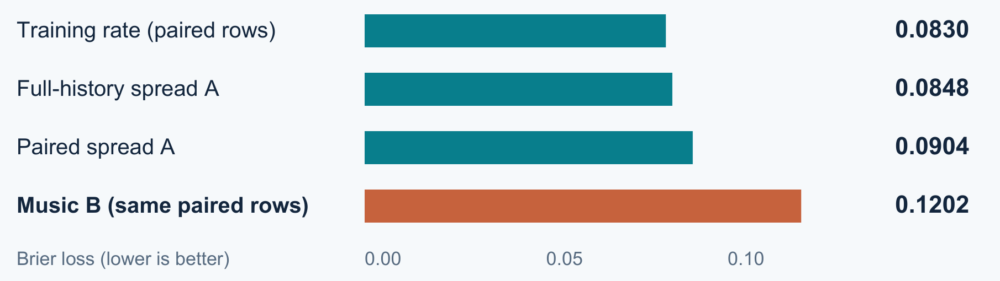
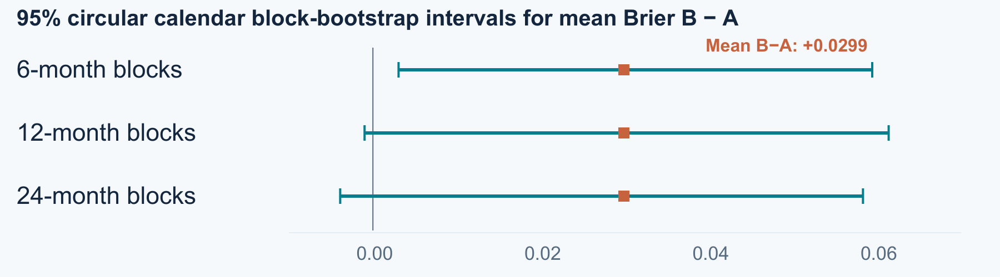

# Can Popular Music Predict U.S. Recessions?

**Final project report · NYU Predictive Analytics · Fall 2026 · Team 5**<br />
Keefer Wu · Nathan Starkman · Kiran Reddy Bhumireddy<br />
Prepared November 17, 2026 · Presentation planning date: December 3, 2026

## 1. Research question and contribution

Do popularity-weighted emotions expressed in popular-song lyrics improve predictions of U.S. recession status beyond the Treasury yield spread? We compare a continuous-spread Probit (Model A) with the same specification augmented by six lyric-emotion features (Model B). The outcome is recession **status in month t+6**, not recession onset anywhere during the next six months. Both models produce probabilities.

On the primary sample of **183 paired forecasts and 15 recession-positive months**, Brier loss rises from **0.0904 to 0.1202** after adding music. The observed mean loss difference, B minus A, is **+0.029867**. A training-rate reference scores **0.0830** and a full-history spread model scores **0.0848** on the same evaluation dates. Model B also has lower average precision and ROC-AUC than paired A.

The contribution is an implemented, auditable comparison: source matching and coverage gates, frozen lyric scoring, monthly aggregation, chronological paired estimation, saved predictions, and conditional uncertainty analysis. The observed music-model performance is worse on the selected samples, but **robust statistical degradation is not established**. We find no demonstrated incremental benefit from these features under this design; we do not conclude that music contains no economic information.

### Prior work

Harvey (1986) linked the yield-curve slope to future growth, and Estrella and Mishkin (1998) tested the spread in a recession Probit; Model A follows them. Zullow (1991) linked pessimism in song lyrics to later recessions. De Lucio and Palomeque (2023) study music preferences along the business cycle. Foramitti et al. (2025) describe stress and negativity in 1973–2023 Billboard lyrics; our OSF corpus comes from that study. Musthyala et al. (2024) use music features to predict Grammy winners. GoEmotions (Demszky et al., 2020) supplies the emotion labels. Those music studies are descriptive or contemporaneous; we test out-of-sample value beyond the spread.

### Implemented architecture

Weekly Billboard appearances → title/artist/source matching and automated screens → cached per-song GoEmotions scores → monthly popularity-weighted emotion means → economic join by predictor month → paired expanding-window Probit forecasts → saved-result evaluation and conditional inference.

The implementation is organized under `src/music_recession/`: `lyrics_audit.py`, `music_preparation.py`, `emotions.py`, `economic.py`, `baseline.py`, `music_model.py`, `backtest.py`, and `inference.py`. The delivered system is a research pipeline, not a deployed real-time forecasting service. The [archival research report](../COMPLETE_RESEARCH_REPORT.md) retains development history; this report states the integrated findings after PRs #1 and #2.

### Interpretation boundary

The exploratory policy admits automatically screened records for coursework. It does not establish recording identity, human-verified language, release timing or copyright permission. The separate strict evidence policy remains unchanged and admits zero records. Final economic snapshots, retrospective labels and a modern pretrained classifier prevent a historically executable real-time interpretation.

<div class="page-break"></div>

## 2. Data, preparation and measurement

| Source | Use and observed scope |
|---|---|
| FRED GS10, TB3MS and USREC | Continuous monthly Treasury spread and binary future recession status. Bundled economic table: 876 predictor-month rows, April 1953–March 2026. |
| Weekly Billboard Hot 100 archive | Weekly ranks for the 1973–2023 music study; 21,542 title/artist identities. The universe is weekly appearances, not year-end chart membership. |
| OSF historical lyrics | 19,096 selected candidates; 16,290 pass the exploratory automated screens and were scored in the historical inference run. |
| SamLowe/roberta-base-go_emotions | Frozen RoBERTa classifier checkpoint `d75048347613a25d77de8cf6412eaae9fa7b26be`, trained on GoEmotions labels; it replaced the BERT model named in the pitch. This is a pretrained measurement model, not an additional observed recession dataset. |

**Study period.** The pitch planned 1959–2023 (nine recessions). The music study covers 1973–2023, the OSF corpus window; extending back would add the 1960, 1969–70 and 1973–75 recessions. With 240 required training months, paired forecasts start in November 1993 and reach three recessions: 2001, 2007–09 and 2020.

Title/artist normalization and source selection reconcile lyric candidates to chart identities. Version qualifiers, featured credits, instrumentals and uncertain language create exclusion risks; automated matching is not recording verification. Kaggle, LYDIA and lyric APIs were investigated for recovery/audit purposes, but are not additional admitted lyric sources in the reported experiment.

Every weekly appearance receives weight **101 − rank**. Repeated appearances in different weeks intentionally contribute repeatedly; duplicate or invalid chart slots are rejected. For each of six emotions, the monthly feature is the weighted sum over scored appearances divided by scored chart weight. Coverage instead divides scored weight by **all observed chart weight**. Missing lyrics lower coverage and never become zero emotion scores. Incomplete chart months and months with missing rank slots fail preparation; no interpolation manufactures usable observations.

Long lyrics are split into at most **480 content-token chunks**, scored with sigmoid outputs, then pooled by token count. The six fixed features are joy, sadness, fear, anger, nervousness and optimism. They remain separate: no PCA or outcome-driven feature search was used. With six preselected, interpretable features, dimensionality reduction would change the research question; it is not a required mechanical step. No new model or feature selection was added to rescue the observed scores.

### Coverage selects the sample

| Minimum coverage | Coverage-only months | Final feature-eligible months | Evaluated forecasts |
|---|---:|---:|---:|
| 70% primary | 433 | 429 | 183 |
| 75% sensitivity | 352 | 348 | 102 |
| 80% sensitivity | 295 | 291 | 45 |

The feature table contains **612 months**. Four months, December 1976–March 1977, clear coverage but have missing rank slots. Training requirements reduce the final evaluation further. Median weighted coverage falls from **0.924 in the 1980s to 0.608 in 2020–2023**. Higher thresholds alter both training and evaluation samples; they do not isolate the causal effect of better coverage. See [policy](../exploratory_course_policy.md), [source review](../osf_source_use_review.md) and [validation gaps](../lyrics_validation.md).

<div class="page-break"></div>

## 3. Models, calendar and CRISP-DM

The spread is **GS10 minus TB3MS, in percentage points**. A 4% long yield minus a 5% short rate gives −1 percentage point. The implementation already uses its continuous magnitude; it does not replace the spread with an inversion indicator.

**Model A:** `p_A(t+6) = Φ(β0 + β1 × spread_t)`<br />
**Model B:** `p_B(t+6) = Φ(β0 + β1 × spread_t + γ′E_t)`

Here Φ is the standard normal cumulative distribution function and E_t contains the six emotion means. Both are unregularized maximum-likelihood Probit models with an intercept. Model A has two parameters; Model B has eight. A binary outcome is compatible with continuous predictors and probabilistic output. Model B learns means and population standard deviations on training rows only; scaling aids numerical conditioning and does not change ideal unpenalized Probit probabilities. There is no automatic regularization, alternative-estimator fallback or feature deletion after a fitting problem.

### Exact chronological rules

- Predictor month is the observation period **t**, not the issuance date.
- Assumed issuance is the **15th calendar day of t+1**, without a business-day adjustment.
- Target is USREC in **t+6**, anchored to t rather than six months after issuance.
- At each evaluation origin, both models refit on identical feature-eligible predictor rows starting January 1973, with training target month **i+6 ≤ t−1**, equivalently **i ≤ t−7**.
- At least **240 actual eligible training observations** are required; missing months are not filled. Evaluation uses identical successful A/B rows and labels. All three saved runs have zero fit failures.

For example, a November 1993 predictor implies assumed issuance December 15, 1993 and a May 1994 target. Training predictor months must end by April 1993, with targets through October 1993. Primary predictor dates span November 1993–December 2023; targets span May 1994–June 2024. The 183 dates are nonconsecutive across a 362-month span.

This is **retrospective pseudo-out-of-sample** evaluation. The t−1 label rule enforces an assumed chronological boundary, not historical NBER announcement availability. Source publication times, economic vintages and historical chart/lyric availability are not reconstructed. Random train/test splits would violate the chronological design and were not used.

| CRISP-DM phase | Implemented work |
|---|---|
| Business understanding | Incremental recession forecasting question and explicit baseline. |
| Data understanding | Source/identity audit, coverage drift and evidence limitations. |
| Preparation | Matching, exclusions, chunking, weighting, coverage gates and economic join. |
| Modeling | Two paired expanding-window Probit specifications; training-only scaling. |
| Evaluation | Brier, ROC-AUC, average precision, calibration, references and conditional uncertainty. |
| Delivery | Saved research artifacts, reproducible offline checks, final report and timed presentation. |

See the [forecast protocol](../forecast_protocol.md) and [model implementation contract](../model_comparison.md); their early strict-policy status sections are historical, while the [integrated results](../exploratory_results.md) describe the exploratory experiment.

<div class="page-break"></div>

## 4. Paired results and same-date benchmarks

Brier is mean squared probability error; lower is better. ROC-AUC measures ranking. **Average precision (AP)** sums precision weighted by recall increments at distinct score thresholds, grouping ties; it is not trapezoidal precision–recall area.

| Sample | n / positives / episodes | A Brier | B Brier | B−A | A ROC-AUC | B ROC-AUC |
|---|---|---:|---:|---:|---:|---:|
| 70% primary | 183 / 15 / 3 | 0.0904 | 0.1202 | +0.029867 | 0.6462 | 0.4306 |
| 75% sensitivity | 102 / 9 / 2 | 0.0740 | 0.1146 | +0.040664 | 0.8722 | 0.5424 |
| 80% sensitivity | 45 / 4 / 1 | 0.0640 | 0.1206 | +0.056555 | 0.9878 | 0.7012 |

The pitch defined improvement as 100 × (BS_A − BS_B) / BS_A. On the three samples it is **−33.0%**, **−55.0%** and **−88.3%**: Model B's Brier loss is that much higher than paired A's.

| Sample | A AP | B AP | Evaluation prevalence (constant-score AP reference) |
|---|---:|---:|---:|
| 70% primary | 0.1688 | 0.0722 | 0.0820 |
| 75% sensitivity | 0.6295 | 0.1000 | 0.0882 |
| 80% sensitivity | 0.9167 | 0.1604 | 0.0889 |

The 75%/80% dates are subsets of primary dates. Positive-month counts across 2001/GFC/COVID are **8/5/2**, **7/0/2** and **4/0/0**. Matching signs are not independent replications; higher AUCs on stricter samples coincide with disappearing episodes and changed dates.



The training-rate reference uses each origin's saved paired-training recession count divided by training count, not evaluation prevalence. Its exact Brier is **0.0829708**. The full-history A benchmark, **0.0847541**, selects the same 183 dates from existing forecasts trained from April 1953. It has more training history than paired A, whose eligible history starts January 1973. This is a practical reference; the original equal-training A/B experiment isolates added features. The broad-history A score **0.094921** uses 630 dates and is not a direct comparator to Model B. No model was refitted to make these same-date checks.

Model B assigns probabilities in **[0.3,0.8)** to **44 evaluated months, with one recession**. Primary training windows contain **46–61 positive labels for eight parameters**, giving **5.75–7.625 events per parameter**, including the intercept. These diagnostics do not identify overfitting as the cause. Evidence: [saved verification](../results/closeout_verification.json), [paired analysis JSON](../results/paired_inference.json) and [results narrative](../exploratory_results.md).

<div class="page-break"></div>

## 5. Conditional uncertainty and sensitivity

For each saved paired row, `d_t = (p_B − y)² − (p_A − y)²`. Keefer's integrated implementation resamples the unchanged saved predictions. A circular calendar block bootstrap uses **10,000 draws**, seed **20261026**, and **6/12/24-month blocks**, with 95% percentile intervals. Losses and the observation mask are resampled together; the mean divides by observed forecasts drawn. Empty replicates are dropped and counted. Circular starts give uniform calendar inclusion, but impose artificial adjacency between the endpoints; local stability is an assumption, not established by this data.



| Sample | 6-month block interval | 12-month block interval | 24-month block interval |
|---|---|---|---|
| 70% | [0.003055, 0.059422] | [−0.000991, 0.061378] | [−0.003891, 0.058321] |
| 75% | [0.005031, 0.084646] | [0.003819, 0.086938] | [0.004438, 0.077902] |
| 80% | [−0.001972, 0.133719] | [−0.002745, 0.145452] | [−0.002191, 0.142801] |

| Sample | Approximate HAC p, lag 5 | Lag 12 | Lag 24 |
|---|---:|---:|---:|
| 70% | 0.039930 | 0.059871 | 0.047918 |
| 75% | 0.045109 | 0.051270 | 0.024629 |
| 80% | 0.091107 | 0.100313 | 0.096629 |

HAC uses calendar-month spacing, a Bartlett/Newey–West kernel through lag L with weights `1 − k/(L+1)`, and observed-count normalization n². Missing dates contribute zero **centered estimating-equation scores**, not zero observed losses. The DM-style statistic is mean(d)/HAC-SE with an **approximate Student-t(n−1)** reference and no small-sample variance correction. Lags 5/12/24 are sensitivities; a single-month target does not create overlapping six-month outcome windows or mandate lag 5. The sparse-calendar cross-product ratio is unbounded and is not a correlation coefficient or an estimate of independent months.

The primary 12/24-month intervals include zero; approximate p-values cross .05 across settings. The 75% sample also has a lag-12 p-value above .05 despite percentile intervals excluding zero. These are different approximations. We report every existing setting and do not select one for significance. Bootstrap shares at or below zero are not null-centered p-values. Only three primary recession episodes limit all such approximations.

This uncertainty is **conditional on fixed saved predictions and the selected forecast calendar**. It omits model refitting/training estimation, matching and NLP measurement error, coverage-policy selection and economic vintages. No robust degradation, causal effect or real-time performance claim follows. See [full statistical methods and validation](../paired_inference.md).

<div class="page-break"></div>

## 6. Limitations, conclusion and reproduction

**Measurement and selection.** GoEmotions was trained on Reddit comments and has not been validated on these lyrics; figurative language, repetition and performer persona can affect measurement. The pitch planned a manual review of emotion predictions on a sample of lyrics. It was not performed, so we cannot separate "lyric emotion does not predict recessions" from "GoEmotions does not measure lyric emotion". Automated screens leave recording, language and release evidence incomplete. Declining coverage changes the observed music population and eligibility. The strict-policy registry still admits zero records. Reported instructor guidance for coursework is not a licence or verified rights clearance.

**Temporal and statistical validity.** Final economic values, retrospective recession dating, modern model training and uncertain historical source availability introduce hindsight. The assumed issuance convention cannot solve these issues. Three primary recession episodes, nested threshold samples, gaps and nonstationarity constrain inference. The selected monthly losses do not establish a defensible count of independent observations. Overparameterization is plausible but not established as the explanation.

**Provenance.** Historical scoring used NLP hash `614f862b…`; current `emotions.py` has hash `e5600454…`. An earlier local cache audit found **7,490 shared score vectors identical** and **8,800 songs without a current-hash rerun**. This final-deliverables work does not repeat that cache audit or run inference. Original predictions, configurations and historical manifests remain preserved; they are not rewritten to imply a current-code full rerun. External reviewer ridge, single-emotion, detrending and alternative-lag experiments remain unverified without supplied code/results.

**Conclusion.** Under the declared exploratory design, music features have greater observed loss than paired A on each selected sample, and paired A/B both lose to the primary training-rate reference. The evidence supports no demonstrated incremental benefit from these six features here. It does not establish robust statistical degradation, an absence of economic information in music, or a causal account of the negative result. The contribution is the implemented comparison and its auditable limits. Further measurement validation would be more informative than adding experiments merely to improve scores.

### Reproduction levels

From the checkout root after installing the numerical environment (`python -m pip install -e .` and pytest), replace FRESH with unused output names:

```sh
HF_HUB_OFFLINE=1 TRANSFORMERS_OFFLINE=1 python -m pytest -q
python scripts/verify_saved_results.py --output /tmp/music-verified-FRESH.json
python scripts/run_paired_inference.py --out /tmp/music-paired-FRESH.json
cmp docs/results/paired_inference.json /tmp/music-paired-FRESH.json
python scripts/make_research_figures.py --out /tmp/music-figures-FRESH
```

Saved metrics and conditional inference reproduce from bundled predictions; the ten original figures reproduce from bundled derived data. Full lyric inference separately needs external raw data, untracked audit/inventory intermediates, optional NLP dependencies, weights and compatible historical/current caches. It is not established by the offline checks. The [PR #1 validation](../closeout_validation.md) and [PR #2 validation](../paired_inference.md#offline-reproduction-and-validation) are historical records: PR #2's integrated offline run passed **215 tests** with no failures/skips. This documentation-only delivery preserves those records; its export and content checks are recorded in [final validation](validation.md).

<div class="page-break"></div>

## 7. References and supporting evidence

1. Federal Reserve Bank of St. Louis, FRED: [GS10](https://fred.stlouisfed.org/series/GS10), [TB3MS](https://fred.stlouisfed.org/series/TB3MS), [USREC](https://fred.stlouisfed.org/series/USREC). The repository uses existing local snapshots; historical vintages and publication timestamps are not supplied. [Economic manifest](../data_manifest.json).
2. [Weekly Billboard Hot 100 archive](https://github.com/mhollingshead/billboard-hot-100). Weekly appearances define the music universe. Repository source/coverage history: [archival report §4–5](../COMPLETE_RESEARCH_REPORT.md#4-complete-data-documentation).
3. [OSF historical lyrics corpus](https://osf.io/2k7ut/). Matching and source-use qualifications: [OSF source review](../osf_source_use_review.md), [exploratory course policy](../exploratory_course_policy.md). No raw lyric text is included in these deliverables.
4. [SamLowe/roberta-base-go_emotions model card](https://huggingface.co/SamLowe/roberta-base-go_emotions). The pinned classifier is used as a frozen measurement model. Its application to these lyrics is not validated. [Inference implementation](../../src/music_recession/emotions.py).
5. [statsmodels Probit documentation](https://www.statsmodels.org/stable/generated/statsmodels.discrete.discrete_model.Probit.html). Implemented estimators and date rules: [baseline code](../../src/music_recession/baseline.py), [paired music model](../../src/music_recession/music_model.py), [forecast protocol](../forecast_protocol.md).
6. Keefer Wu, integrated paired-inference implementation: [code](../../src/music_recession/inference.py), [CLI](../../scripts/run_paired_inference.py), [methods and assumptions](../paired_inference.md), [tests](../../tests/test_inference.py). These specify the exact bootstrap/HAC conventions rather than claiming a uniquely canonical analysis.
7. Original paired experiment: [70% metrics](../results/exploratory_primary_cov70/metrics.json), [75% metrics](../results/exploratory_sensitivity_cov75/metrics.json), [80% metrics](../results/exploratory_sensitivity_cov80/metrics.json). Prediction files in the same directories preserve per-origin dates, training counts and probabilities.
8. Cross-checks: [saved-result verification](../results/closeout_verification.json), [conditional analysis JSON](../results/paired_inference.json), [original figure summary](../figures/music_recession/results_summary.json), [full-history baseline forecasts](../../reports/baseline_backtest/forecasts.csv).
9. Harvey, C. R. (1986). *Recovering Expectations of Consumption Growth from an Equilibrium Model of the Term Structure of Interest Rates*. PhD dissertation, University of Chicago. [Link](https://people.duke.edu/~charvey/research.htm).
10. Estrella, A., & Mishkin, F. S. (1998). Predicting U.S. recessions: Financial variables as leading indicators. *Rev. Econ. Stat.*, 80(1), 45–61. [Link](https://www.nber.org/papers/w5379).
11. Zullow, H. M. (1991). Pessimistic rumination in popular songs and newsmagazines predict economic recession via decreased consumer optimism and spending. *J. Econ. Psychol.*, 12(3), 501–526. [Link](https://www.sciencedirect.com/science/article/abs/pii/016748709190029S).
12. de Lucio, J., & Palomeque, M. (2023). Music preferences as an instrument of emotional self-regulation along the business cycle. *J. Cult. Econ.*, 47(2), 181–204. [Link](https://doi.org/10.1007/s10824-022-09454-7).
13. Musthyala et al. (2024). Grammy-winner prediction from music features, as cited in the pitch. [Link](https://ieeexplore.ieee.org/document/10607237).
14. Foramitti, M., Nater, U. M., Lamm, C., & Martins, M. (2025). Societal crises disrupt long-term increases in stress, negativity, and simplicity in US Billboard song lyrics from 1973 to 2023. *Sci. Rep.*, 15. [Link](https://www.nature.com/articles/s41598-025-28327-5).
15. Demszky, D., et al. (2020). GoEmotions: A dataset of fine-grained emotions. *ACL 2020*. [Link](https://aclanthology.org/2020.acl-main.372/).
16. Project review history: [PR #1](https://github.com/kirankigi5/music_as_recession_alternate_data/pull/1), [PR #2](https://github.com/kirankigi5/music_as_recession_alternate_data/pull/2), [review dispositions and syllabus checklist](../review_response.md#final-deliverable-checklist). Reviewer-reported experiments are not treated as verified results.

### Final-deliverable mapping and open confirmations

The research question supplies the problem statement; Sections 2–3 document sources, CRISP-DM, cleaning, feature decisions, models and architecture; Sections 4–5 supply evaluation; Section 6 records limits and reproduction. PCA, random splitting and additional models were not added mechanically. The negative result is reported without score-driven redesign.

The [presentation](presentation.pptx), [PDF slides](presentation.pdf), [speaker notes](speaker_notes.md) and [team handoff/email draft](team_handoff.md) accompany this report. December 3, 2026 and a 12:30 slot are planning constraints. Q&A inclusion, official submission deadline, report/deck format or length rules, required upload destination and final team speaker assignments remain unconfirmed. The exact TA yield-spread clarification is drafted in the handoff; the existing model is unchanged.
