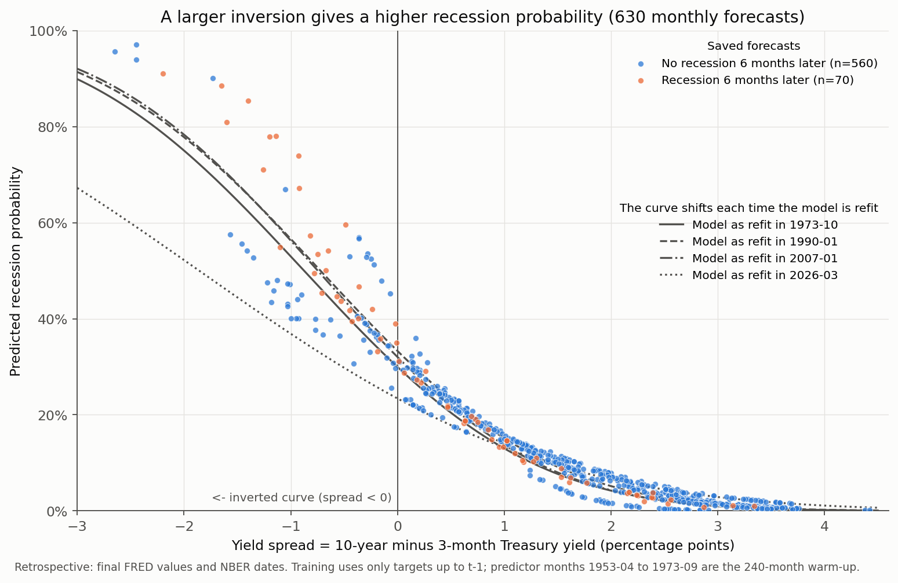
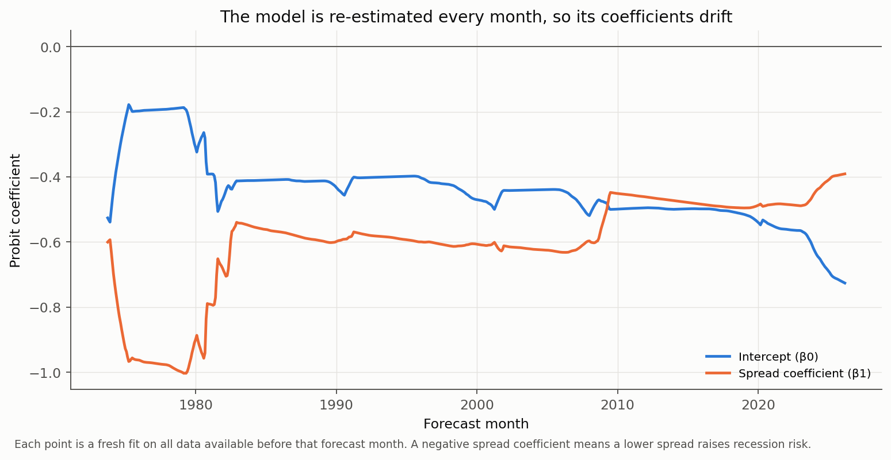
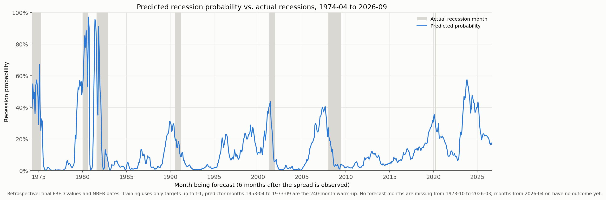

# Yield-spread follow-up

## 1. The spread is already a number, not a 1/0 flag

Our models use **spread = 10-year yield (GS10) − 3-month yield (TB3MS)**, in
percentage points. The code never turns it into a 1/0 "inverted or not" flag.

The difference matters. A flag treats −0.01 and −2.45 the same. The actual number
tells the model *how* inverted the curve is.

| Month | GS10 | TB3MS | Spread | Predicted recession probability (6 months later) | Recession happened? |
|---|---:|---:|---:|---:|---|
| Oct 1973 | 6.79 | 7.22 | −0.43 | 39.4% | Yes |
| Dec 2006 | 4.56 | 4.85 | −0.29 | 38.9% | No |
| Jan 2023 | 3.53 | 4.54 | −1.01 | 47.2% | No |

A flag would score all three months as "1." The model gives each a different
probability. Exact values are in [`worked_examples.json`](figures/yield_spread/worked_examples.json).

**Where to check in the code:**
- `economic.py` computes the spread.
- `baseline.py` (Model A) and `music_model.py` (Model B) use it as a number.
- Existing tests in `tests/test_economic.py` and `tests/test_baseline.py` confirm this.

## 2. How to read the probabilities

The baseline model is `P(recession in month t+6) = Φ(β0 + β1 × spread_t)`.

- **What actually happens** is yes or no: is month t+6 a recession month?
- **The model's output** is a probability from 0% to 100%. We score the probabilities
  directly, without cutting them off at 50%.
- **The model is refit every month** using only data available at that time, so its
  coefficients change over time. There is no single fixed curve.
- **Forecasts cover** every month from Oct 1973 to Mar 2026 (630 forecasts). Earlier
  months are only used for training. Months from Apr 2026 on have no outcome yet.
- **It's retrospective:** it uses today's final data, not what was known back then.

**Spread vs. probability.** More inverted spreads give higher probabilities. The
gray lines show the model at four points in time; the curve moves as it is refit.

**Coefficients over time.** Each monthly refit gives slightly different numbers.

**Probability over time.** The probability rises before most recessions (gray), but
often peaks only around 40%. It gave a false alarm in 2023–24 and missed COVID.

## 3. Extra test: does the *change* in spread help?

> **Supplementary:** a separate test, not part of the original experiment.

We added one feature, **Δspread = this month's spread − last month's spread**. It is
only computed when last month's data actually exists. We compared:

- **Spread only** (the normal model)
- **Spread + Δspread**

Both models were refit every month on the **same 629 months** (Nov 1973 – Mar 2026),
using the same rules. That sample has 69 recession months across 7 recessions. We did
no tuning.

| Metric | Spread only | Spread + Δspread |
|---|---:|---:|
| Brier score (lower = better) | 0.0944 | 0.0924 |
| ROC-AUC (higher = better) | 0.717 | 0.742 |
| Average precision (higher = better) | 0.304 | 0.340 |
| Log loss (lower = better) | 0.337 | 0.333 |

**What it means:**
- Adding Δspread was **slightly better on every metric**, with about a 2% lower Brier score.
- Most of the gain came during recession months.
- A rising spread raised the predicted risk. This fits a known pattern: the curve often
  steepens just before a recession, when the Fed starts cutting rates.
- **The improvement is not statistically clear.** The 95% ranges for the Brier
  difference include zero (about −0.007 to +0.003), and the p-values are about 0.4.
  With only 7 recessions, we can't tell it apart from noise.

**Conclusion:** Δspread may help a little, but the evidence is weak. We kept the
original model unchanged.

## Files and how to rerun

| What | Where |
|---|---|
| Results | [`results/supplementary_spread_change/`](results/supplementary_spread_change/) (`metrics.json` has every number) |
| Model code | `src/music_recession/spread_change.py` |
| Rerun the comparison | `python scripts/run_spread_change_comparison.py --out <new folder>` |
| Redraw the figures | `python scripts/make_spread_probability_figure.py --out <new folder>` |
| Tests | `tests/test_spread_change.py` |
